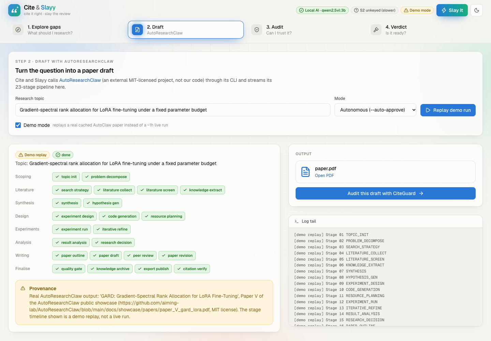
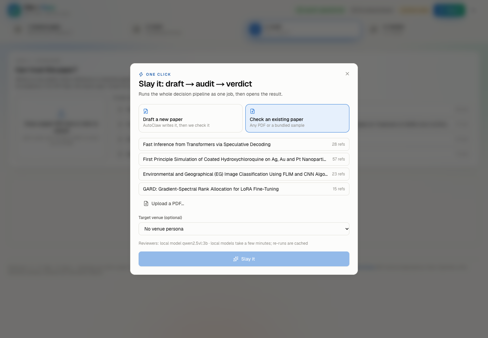
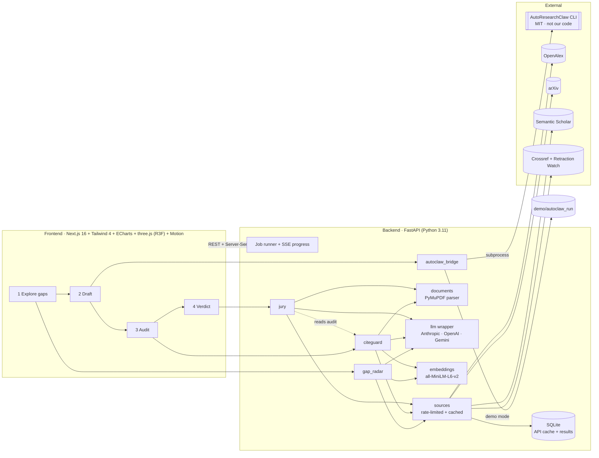

# Cite and Slayy

**Cite it right. Slay the review.** A decision layer for AI-written research.

> **AutoClaw can write a paper. Cite and Slayy tells you whether you should write it, whether you can trust it, and whether it's ready.**

Built for the **GDGOC APU Hackathon**, track *Data-Driven Research & Intelligent Decision Making*.

[AutoResearchClaw](https://github.com/aiming-lab/AutoResearchClaw) turns a research idea into a paper draft. Cite and Slayy wraps it with the decisions around that draft:

| Question | Module | What it does |
|---|---|---|
| **What should I research?** | **Gap Radar** | Clusters 300–2,000 recent papers from OpenAlex + arXiv. Classifies each sub-topic as *Rising / Saturated / Underexplored* with visible thresholds. Proposes research questions grounded in real papers. |
| *(write it)* | **AutoClaw bridge** | Sends the chosen question to AutoResearchClaw's CLI and streams its 23-stage pipeline. Includes a demo mode that replays a real cached run. |
| **Can I trust this paper?** | **CiteGuard** | Checks for **any** PDF: reference existence, retractions (including of the paper itself), claim–citation support, tortured phrases and overlap hotspots. Every flag shows its evidence. |
| **Is it ready, and where?** | **Reviewer Jury** | A rule-based readiness checklist, four LLM reviewer personas and an optional venue persona, combined with CiteGuard into **Submit / Revise / Don't submit**. Includes a ranked fix list, a downloadable report and venues where similar real work was published. |
| **All of it, now** | **Slay it** ⚡ | One click (or press **S**): draft (or pick any paper) → audit → verdict as a single job with live progress. |

**Runs with no API keys.** If no cloud key is set, it uses a free local model through [Ollama](https://ollama.com).

<p align="center">
  
</p>
<p align="center">
  
  
  
  
  
</p>

---

## Contents

1. [Credits and what is ours](#1-credits-and-what-is-ours)
2. [Quick start](#2-quick-start)
3. [Architecture](#3-architecture)
4. [How each module works](#4-how-each-module-works)
5. [The "never fabricate" guarantees](#5-the-never-fabricate-guarantees)
6. [API reference](#6-api-reference)
7. [CLI, demo mode and cache warm-up](#7-cli-demo-mode-and-cache-warm-up)
8. [Testing](#8-testing)
9. [Known limitations](#9-known-limitations)
10. [Project structure and team split](#10-project-structure-and-team-split)

---

## 1. Credits and what is ours

**AutoResearchClaw** ([aiming-lab/AutoResearchClaw](https://github.com/aiming-lab/AutoResearchClaw), MIT license, by AIMING Lab) is an **external dependency**. Cite and Slayy only:

- invokes its CLI (`researchclaw run --topic "…" …`) as a subprocess;
- reads its output folder (`artifacts/rc-*/deliverables/`).

None of its code is copied into this repository.

The demo draft in `demo/autoclaw_run/deliverables/paper.pdf` is **Paper V of the AutoResearchClaw public showcase**: *GARD: Gradient-Spectral Rank Allocation for LoRA Fine-Tuning* ([source](https://github.com/aiming-lab/AutoResearchClaw/blob/main/docs/showcase/papers/paper_V_gard_lora.pdf), MIT). It is redistributed with attribution and labelled in the UI as a replay.

**White-label UI.** The website itself presents every AI feature as *Azora AI* and never names the drafting engine, the AI
vendor or the model: `/api/health` and verdicts expose only `"Azora engine"`, and error messages pass through `llm.scrub()`.
The attribution above (and in `THIRD_PARTY_NOTICES.md`) stays in the repository, as the MIT license and the hackathon rules require.

**Our original code:** everything under `backend/` (Gap Radar, CiteGuard, Jury, bridge, LLM wrapper, cache), `frontend/` and `scripts/`.

**Data sources (all free):**

| Source | Used for |
|---|---|
| [OpenAlex](https://openalex.org) | Bulk paper retrieval, abstracts, citation counts, venues |
| [arXiv API](https://info.arxiv.org/help/api/) | Recent preprints |
| [Semantic Scholar Graph API](https://api.semanticscholar.org) | Title matching, abstracts |
| [Crossref REST API](https://api.crossref.org) | DOI resolution, bibliographic matching, retraction/correction notices (including Retraction Watch data that Crossref distributes) |

**Tortured-phrase seed list:** `data/tortured_phrases.csv` is transcribed from Table 1 of Cabanac, Labbé & Magazinov (2021), *Tortured phrases: A dubious writing style emerging in science* ([arXiv:2107.06751](https://arxiv.org/abs/2107.06751)). Each `(a | b)` alternative is expanded into its own row, and every row links its source. The `verified_by` column is empty until a team member signs each row off.

**Sample papers in `demo/sample_pdfs/`** are real, openly available papers, used only to demonstrate the checks:

| File | What it is | Why it's in the demo |
|---|---|---|
| `retracted_PMC9402320.txt` | Full text of *Environmental and Geographical (EG) Image Classification Using FLIM and CNN Algorithms*, DOI 10.1155/2022/4989248 (CC BY), from PMC's open-access dataset | Crossref lists retraction notice 10.1155/2023/9780628 (source includes Retraction Watch) |
| `hcq_nanoparticles_covid_preprint.pdf` | A 2020 COVID-19 preprint | Cites Gautret et al. 2020 (IJAA, 10.1016/j.ijantimicag.2020.105949), which Crossref shows as retracted (notice 10.1016/j.ijantimicag.2024.107416) |
| `clean_speculative_decoding_arXiv2211.17192.pdf` | Leviathan, Kalman & Matias, *Fast Inference from Transformers via Speculative Decoding* (arXiv:2211.17192) | A clean baseline |

---

## 2. Quick start

**Prerequisites:**
- [uv](https://docs.astral.sh/uv/). It installs Python 3.11 for you.
- Node.js 20+.
- Internet access for the scholarly APIs.

```bash
cd cite-and-slayy
cp .env.example .env              # optional: add an API key and CONTACT_EMAIL (see below)
ollama pull qwen3.5:9b && ollama serve   # optional: free local AI if you have no API key
uv sync                            # Python 3.11 venv + dependencies (first run downloads torch, ~2 min)
cd frontend && npm install && cd ..

./scripts/dev.sh                   # backend :8000 + frontend :3000
# or separately:
uv run uvicorn backend.app.main:app --port 8000 --reload
cd frontend && npm run dev
```

Open <http://localhost:3000> (landing page) or <http://localhost:3000/app> (the app). The header chips show what is active: the AI model (local or cloud), the Semantic Scholar key and demo mode.

**Shortcuts:** `1`–`4` switch tabs, `S` opens *Slay it*.

### Environment variables (`.env`)

| Variable | Needed for | Notes |
|---|---|---|
| `LLM_PROVIDER` | Claim support, cluster labels, research questions, jury | `auto` (default): **local Ollama first** (free, no API cost), else the first cloud key found, else none. Or force `anthropic` \| `openai` \| `gemini` \| `ollama` \| `none`. |
| `ANTHROPIC_API_KEY` / `OPENAI_API_KEY` / `GEMINI_API_KEY` | Cloud providers | Default models: `claude-opus-5-5`, `gpt-4.1-mini`, `gemini-2.5-flash`. Override with `LLM_MODEL`. |
| `OLLAMA_URL` / `OLLAMA_MODEL` | Local AI | Default `http://localhost:11434`. The model is auto-picked from those installed, preferring text models over vision ones. `qwen3.5:9b` is recommended on 16 GB RAM (6.6 GB); its thinking mode is switched off for speed. |
| `CONTACT_EMAIL` | Crossref / OpenAlex polite pools | Strongly recommended: more reliable and allows more concurrency |
| `S2_API_KEY` | Semantic Scholar | [Free key](https://www.semanticscholar.org/product/api). Unkeyed requests share a heavily rate-limited pool. |
| `OPENALEX_API_KEY` | Large Gap Radar scans | Optional. Without it, Cite and Slayy uses page-based paging. |
| `DEMO_MODE` | Draft tab | `true` replays the cached AutoClaw run |
| `AUTOCLAW_BIN`, `AUTOCLAW_CONFIG`, `AUTOCLAW_WORKDIR` | Live AutoClaw runs | See [§4.2](#42-autoclaw-bridge) |
| `TORTURED_REQUIRE_VERIFIED` | CiteGuard | `true` ignores phrase rows with an empty `verified_by` |

**AI options.** With `auto`, a running local model always wins, so API keys are only a fallback:

1. **A cloud key:** fastest, and the strongest reviews. Used only when Ollama isn't running, or when you set `LLM_PROVIDER` to that provider.
2. **Local Ollama:** free and offline. Local models get a condensed paper text (opening + ending, ~28k characters), and the verdict says so. Claim checks are batched 4 at a time. Every LLM response is cached in SQLite, so re-running the same audit or verdict is instant.
3. **No LLM at all:** everything else still runs, and LLM features report "not assessed" rather than guessing:
   - claim support shows similarity only;
   - cluster labels fall back to keywords;
   - research questions are disabled;
   - the jury is just the rule-based checklist, so the verdict can be at best *Revise*.

### Live AutoResearchClaw (optional)

```bash
git clone https://github.com/aiming-lab/AutoResearchClaw.git && cd AutoResearchClaw
pip install -e . && researchclaw setup && researchclaw init     # creates config.arc.yaml
```

Then set `DEMO_MODE=false`, `AUTOCLAW_CONFIG=/path/to/config.arc.yaml` and optionally `AUTOCLAW_WORKDIR`. Untick *Demo mode* in the Draft tab.

---

## 3. Architecture



**Design points:**

- **One gateway to the outside world.** `backend/sources/http.py` is the only code that calls external APIs. It provides:
  - per-source rate limiting and concurrency limits;
  - retries with back-off on 429/5xx;
  - caching of successful responses in SQLite, together with their fetch time.
- **Long work runs as jobs.** Every slow operation (`POST` scan / run / audit / review) returns a `job_id`. The UI follows `GET /api/jobs/{id}/events` (Server-Sent Events), so progress bars are real.
- **Standalone tabs.** Each tab works on its own: you can upload any PDF straight into *Audit*. The tabs also chain: Explore → *Send to AutoClaw* → *Audit this draft* → *Get the verdict*. State persists in `localStorage`, and deep links work: `/?tab=audit&doc=<id>&audit=<id>`.

### Interface: "Slay Pop", animated and 3D, and honest

- **Look:** a neo-brutalist design system, built from:
  - cream paper, chunky ink outlines, and hard offset shadows that press when clicked;
  - candy colour blocks (pink, lime, electric blue, yellow) with sticker badges and scrolling marquees;
  - Bricolage Grotesque display type;
  - a dark mode with neon-pink shadows.
- **`/` is a landing page:**
  - a spring-animated hero beside a live 3D research galaxy from your latest real scan;
  - live counters from `/api/stats`;
  - "how it works", and a bento of **real catches** from the demo audits;
  - the "no fake data" principles, and a one-click **Slay it** CTA.
- **`/app` is the app:** a left sidebar with the 4 steps (each with its own colour), the Slay it button, and AI/status chips. On mobile it becomes a bottom bar.
- **3D with real data only:**
  - the Gap Radar galaxy, where orbs are clusters and dots are papers;
  - the **citation constellation** in Audit, where the paper is the core and every reference orbits it. Status shows as colour **and** shape, retracted citations pulse, and clicking a node opens its evidence.
- **Motion:**
  - spring page transitions and count-up numbers;
  - 3D-flipping jury cards, with confetti only on a genuine *Submit*;
  - shaking retraction alarms, and a scroll-progress bar.
- **Accessibility:** everything respects the OS *reduce motion* setting, and status is never shown by colour alone.

---

## 4. How each module works

### 4.1 Gap Radar

`backend/gap_radar/`

1. **Ingest.**
   - Pulls papers from OpenAlex (`search` with `has_abstract:true`, from the chosen year) and adds recent arXiv preprints.
   - Deduplicates by DOI, then by normalised title.
2. **Embed and cluster.**
   - Embeds `title. abstract` with all-MiniLM-L6-v2.
   - Clusters with **KMeans, choosing k ∈ [6, 15] by silhouette** (deterministic, so it's predictable on stage). HDBSCAN is optional.
3. **Label.**
   - The LLM names each cluster from its 8 most central papers.
   - Without an LLM, Cite and Slayy uses c-TF-IDF keywords, and the UI says so.
4. **Metrics per cluster:**
   - papers per year;
   - **growth** = CAGR of the paper count over the last 3 complete years (+1 smoothing);
   - **recency** = share of papers from the last 12 months;
   - **citations/year** = mean of citations ÷ years since publication. Normalising by age keeps new topics from being penalised.
5. **Classification** is relative to the field's own medians, and the rules are shown in the UI:

   | Class | Rule |
   |---|---|
   | Rising | growth ≥ 1.5 × field median growth **and** recency ≥ field median |
   | Underexplored | size in the bottom tertile **and** citations/year > field median (attention without volume) |
   | Saturated | size in the top tertile **and** growth ≤ field median |
   | Unclassified | none of the above. Clusters are never forced into a box. |

6. **Research questions.**
   - The LLM sees a numbered list of real papers: the cluster's 15 most central plus 5 from each of the 2 nearest clusters.
   - It must cite them by number. Any question citing a number not on the list is **dropped**, and the UI reports how many were dropped.
7. **Charts** follow a validated palette: the first three categorical slots pass the colour-vision-deficiency (CVD) and contrast checks in both themes.
   - Unclassified is drawn **hollow and dashed**, so it is never told apart by colour alone.
   - The heatmap uses a single-hue sequential ramp.

### 4.2 AutoClaw bridge

`backend/autoclaw_bridge/runner.py`

- **Live mode** runs:
  ```
  researchclaw run --topic "<topic>" [--config <cfg>] (--auto-approve | --mode <co-pilot|gate-only|express>)
  ```
  It scans stdout for the 23 stage names (`TOPIC_INIT` … `CITATION_VERIFY`) and then picks the newest `artifacts/rc-*/deliverables/`. The largest PDF found is registered for auditing.
  - Co-pilot and gate modes pause for human approval. Answer those in a terminal with `researchclaw attach` / `researchclaw approve`. The UI tells you this.
- **Demo mode** replays `demo/autoclaw_run/` (a real showcase paper) with a quick stage timeline. Both the UI and the log say *demo replay*. If you request a different topic, it states that it returns the cached run.

### 4.3 CiteGuard

`backend/citeguard/` and `backend/documents/`

**Parsing** uses PyMuPDF and works with PDFs and plain `.txt` files (e.g. PMC full texts).

- *Reference sections:* found by heading, or by a trailing numbered list.
- *Splitting:* handles `[n]`, `(n)`, `n.` and author–year styles, and picks the one that yields the most entries.
- *Cleanup:* strips running headers, page numbers and figure captions, and re-joins DOIs broken across lines.
- *In-text citations:* links `[3]`, `[3–5]`, `(Smith et al., 2020)` and `Smith et al. (2020)`.

| # | Check | How | Statuses |
|---|---|---|---|
| 1 | **Reference existence** | Crossref by DOI, then Crossref bibliographic search, then arXiv id, then Semantic Scholar title match, then OpenAlex. Matching compares the full title, or a near-literal containment of the candidate title in the reference string. A search hit whose **year and first author both disagree is treated as a different paper**. Short titles need year + author agreement. If the PDF text mangled the title, a Crossref match on author + year + volume + page is accepted. Web resources (URL, no DOI) are reported as unverifiable, not guessed. | Verified · Metadata mismatch (field-level diff) · Not found · Could not verify |
| 2 | **Retractions** | Crossref `updated-by` on the record **plus** `filter=updates:{doi}`. Checked for **every matched version** (preprint *and* journal article); the most severe status wins. The **uploaded paper itself** is checked too. | Retracted · Corrected · Expression of concern · No notices · Not covered (no Crossref DOI) · Could not verify |
| 3 | **Claim support** | The citing sentence and the cited abstract (OpenAlex, then S2) are compared by embedding cosine, plus an LLM judgment in batches of 8 (strict JSON schema). The LLM label is authoritative and the similarity is shown next to it. **No abstract → Unclear, never Unsupported.** | Supported · Unclear · Unsupported · Not assessed |
| 4 | **Tortured phrases** | Phrase list from `data/tortured_phrases.csv`. Matching is case-insensitive, tolerates line breaks and hyphenation, and allows a plural `s`. Each hit shows its context and source. | hit list |
| 5 | **Overlap hotspots** | Paragraph embeddings vs. abstracts of cited and top-10 related works (OpenAlex, excluding the paper itself and its other versions). Flags cosine ≥ 0.85 and shows the closest abstract sentence. Labelled **"possible overlap"**, never "plagiarism". | hit list |

**Integrity score (0–100).** Each term is shown in the UI with its formula and inputs:

```
references = 40 × (verified + 0.5·mismatch) / (verified + mismatch + not_found)     could_not_verify excluded
claims     = 30 × (supported + 0.5·unclear) / assessed                             only LLM-labelled claims with an abstract
phrases    = 15 × max(0, 1 − hits/3)
overlap    = 15 × (1 − flagged_paragraphs / paragraphs)

score = 100 × Σ(available terms) / Σ(their maxima)  −  15 × retracted citations     (floor 0)
score = 0 if the uploaded paper itself is retracted
low confidence if > 30% of references could not be verified, or fewer than 2 terms were available
```

Checks that could not run are **excluded**, not counted as passes. A retracted citation caps the score colour at amber.

### 4.4 Reviewer Jury and verdict

`backend/jury/`

- **Checklist (rule-based) reviewer.** Always runs, needs no LLM, and is fully deterministic. It looks for concrete evidence of:
  - an abstract, a limitations section, and a code/data availability statement;
  - an ethics or conflict-of-interest statement;
  - statistical reporting (± / CIs / p-values) and reproducibility details (seeds, hyperparameters);
  - at least 2 figures/tables referenced, and at least 20 references;
  - recent literature, measured relative to the paper's own newest citation;
  - CiteGuard's not-found and retracted counts.

  Its score is 1 + 9 × passed/total, and every check is listed with what was found. It checks structure and reporting, **not** scientific quality, so **Submit additionally requires at least one LLM content reviewer**.
- **LLM personas:** Methods, Novelty, Clarity, Ethics & Reproducibility, plus an optional Venue persona.
  - Each returns validated JSON: `score 1–10`, 3 weaknesses, 3 fixes, `confidence 0–1`, summary.
  - Out-of-range or invalid output is retried once, then reported as *Not assessed*. It is never coerced.
  - The Novelty persona also gets 10 real related papers from OpenAlex.
  - The Venue persona is told it has no access to the venue's current call for papers.
- **Where to submit:** venues of the closest real OpenAlex papers. Repositories are excluded, as is the paper itself.
- **Verdict rules**, evaluated in order. The fired rules are shown as the reasoning.

  | Decision | When |
  |---|---|
  | **Don't submit** | the paper itself is retracted · ≥ 3 references not found · integrity < 50 · jury weighted mean < 5 |
  | **Revise** (floor) | any reference not found, or any cited work retracted |
  | **Submit** | weighted mean ≥ 7 **and** every persona ≥ 5 **and** integrity ≥ 80 **and** no floor rule |
  | **Revise** | otherwise, including a missing audit or missing jury |

  The weighted mean is Σ(score·confidence) ÷ Σ confidence.
- **Ranked fix list** is ordered as follows:
  1. Blocking CiteGuard issues: self-retraction, retracted citations, references not found.
  2. Other CiteGuard issues: unsupported claims, tortured phrases, metadata errors, overlap.
  3. Persona fixes, ranked by (10 − score) × confidence. Near-duplicate fixes from different personas are merged by embedding similarity.

---

### 4.5 Paper Studio (topic in, full paper out)

`backend/paper_studio/studio.py` runs a team of agents and streams each one's status to the UI:

| Agent | What it does |
|---|---|
| Scout | Plans 3 searches, pulls real papers with abstracts from OpenAlex, reranks them by embedding similarity to the topic, and drops anything Crossref lists as retracted or under an expression of concern. |
| Analyst | Measures yearly publication counts for 2 key phrases (OpenAlex `group_by`) and draws the figures with matplotlib: the trend, the age of the cited works, and their citation impact. |
| Architect | Designs the title, research question, contributions, the proposed method and a brief for each section. |
| 6 Writers (parallel) | Write the Introduction, Related Work, Proposed Method (equations + architecture diagram), Bibliometric Analysis (results), Experimental Protocol (planned evaluation + workflow diagram), and Discussion & Conclusion. |
| Editor | Writes the abstract, keywords, 4 highlights and a plain-language summary. |
| Verifier | Removes out-of-range citation numbers. Flags 8-word verbatim overlap and close paraphrase (embeddings) against the cited abstracts, unsupported citation claims (sampled), unmeasured numbers or results claimed for the unrun method, tortured phrases, and malformed LaTeX. |
| Reviser | Rewrites flagged paragraphs and repairs equations. Citations are then renumbered in order of first use (IEEE style). |

**Honesty by construction.** Every reference is a real record with a DOI or URL. Every number in the paper comes from
FACTS we measured, or from a cited abstract. The proposed method is never claimed to have results: its evaluation is a
protocol whose cells read "to be measured". Tables of trend counts and key works are generated in code, not by the model.
An optional acknowledgment discloses AI assistance. The integrity report is shown with the paper. Downloads: PDF (print
view with figures), Word (figures and diagrams embedded) and LaTeX `.zip` (`main.tex` + `figures/`, IEEE or Springer LNCS).

### 4.6 Workspace, pins and AI assist

- **Notes:** Notion-style Markdown pages with live KaTeX and Mermaid, a paper template, an AI menu (continue, improve, summarise, outline, explain) and IEEE/Springer export.
- **Sticky board:** drag notes, heart-vote them, *Tidy up* (sorted grid), *AI brainstorm* (a topic becomes 5 idea stickies), and AI expand per note.
- **Pins anywhere:** the 📌 button (or Ctrl/⌘+V outside a text box) drops a sticky note on any screen; a note can be shown on every screen.
- **To-dos:** quick-add syntax (`!high #tag @tomorrow`), due dates, tags, subtasks, *AI: break down*, *AI: plan my day*, a progress ring and a Pomodoro focus timer.
- All AI actions go through `POST /api/assist`.

### 4.7 Arcade

There are three original 3D games built with React Three Fiber (*Neon Runner*, *Ring Flyer*, *Bubble Pop*), plus three research games
(*Tortured Phrase Quiz*, *Acronym Memory*, *Catch the Retraction*). While a paper is generating, a floating progress pill follows
you around the app and announces when the paper is ready.

### 4.8 Accounts, plans and payments

- **Sign-in:** Google (ID token verified server-side with `google-auth`) or emailed magic links. Sessions are HMAC-signed cookies.
  With `AUTH_REQUIRED=true`, every `/api` call needs a user, and papers, documents, audits, verdicts, chats, notes and pins are
  private to their owner (`owners` table, `backend/accounts/auth.py`).
- **Plans** (`backend/accounts/plans.py`): Free ₹0, Pro ₹6,999/month, Max ₹12,999/month, GST-inclusive. Pro and Max run papers,
  revisions and verdicts on the Pro engine (`PREMIUM_MODEL`, Anthropic API) with the standard engine as fallback.
- **Margins are enforced, not hoped for.** Every model call records its real token usage and cost against the user, and each
  plan has a monthly AI budget (Pro ₹900, Max ₹4,000) alongside its count limits. After GST and the gateway fee, at least
  ~63–84% of each subscription is left for AWS and profit, even at full use. Failed jobs refund their quota automatically.
- **Payments:** Razorpay Subscriptions. Plans are created by API on first use, Checkout authorises the mandate, the payment
  signature is verified server-side, and `subscription.*` webhooks (HMAC-verified, exempt from the site password) keep each user's
  plan in sync. Upgrading cancels the previous subscription; cancelling keeps access until the period ends.
- **Legal pages** (`/terms`, `/privacy`, `/refund`, `/contact`) take business details from `frontend/lib/business.ts`.
  Fill those in before applying for Razorpay activation.

### 4.9 Revisions, study papers and venue finder

- **Revise in plain language:** `POST /api/paper-studio/{id}/revise` plans which sections change, rewrites them in parallel
  with the same numbered references and measured facts, then re-checks citations, numbers and LaTeX. It keeps an undo history.
- **Your own study papers:** uploaded PDFs are matched to real records (DOI, then title) and always cited. Unmatched files are reported, never cited.
- **Journal / conference finder:** `POST /api/venues/find` ranks venues by where the most similar papers of the last 6 years
  were published (embedding-weighted), with OpenAlex facts: type, publisher, open access, DOAJ, APC, h-index and 2-year mean citedness.

### 4.10 Submission kit, originality fixer, Azora writes papers

- **Submission kit** (`backend/paper_studio/kit.py`): cover letter and declarations written from the paper's own content
  (unknowns left as [placeholders]); a pre-submission checklist computed from the manuscript (abstract length, keywords,
  references, captions, pending “to be measured” results, AI disclosure, integrity report); reviewer candidates taken from
  authors of cited works; and a response-to-reviewers template. Export to Word or Markdown.
- **Originality fixer** (`backend/citeguard/fixer.py`): for each possible-overlap paragraph in an audit, suggests a rewrite in
  original words with an in-text citation to the matched source, and shows shared wording (3-word sequences) before and after.
  It does not try to hide AI use; papers carry an AI-assistance acknowledgment.
- **Diagrams:** every Mermaid block is validated against a strict flowchart grammar, repaired or dropped before it reaches a
  paper, unclosed fences are closed, and each paper gets an experimental-workflow flowchart.
- **Azora AI `write_paper` tool:** Azora can pick a topic from a field scan and trend experiments, then run the full Paper Studio.

## 5. The "never fabricate" guarantees

| Rule | Where it's enforced |
|---|---|
| Every citation check hits a real API | `sources/` is the only network layer. The cache stores only real responses, with their `fetched_at` time, and never caches errors. |
| An API failure is never "verified" (or "not found") | `not_found` requires **every** resolver to answer successfully. Any failure without a match becomes `could_not_verify`. |
| Every flag shows its evidence | Each `Evidence` object carries the exact request URL ("API response" link), a human-readable record link, the matched fields (title similarity, year, DOI, authors) and the note. Retraction flags link the notice DOI. |
| The LLM can't invent sources | Questions may cite only numbered papers that Cite and Slayy supplied; unknown ids are dropped. Personas are told not to invent facts. Their structured output is validated. |
| Missing information stays missing | No abstract → *Unclear*. No LLM → *Not assessed*. No Crossref DOI → *Not covered*. Web resource → *Could not verify*. |
| Tortured phrases come from a published source | Every CSV row has `source` and `source_url`. Team verification is tracked in `verified_by`. The PPS importer only copies rows from a file you provide. |

---

## 6. API reference

Interactive docs live at <http://localhost:8000/docs>. All long operations return `{ "job_id" }`.

| Method | Path | Purpose |
|---|---|---|
| GET | `/api/health` | Configuration status (LLM, keys, demo mode, phrase count, verdict rules) |
| GET | `/api/jobs/{id}` · `/api/jobs/{id}/events` | Job status · SSE progress stream (ends with `event: end`) |
| POST | `/api/documents` (multipart `file`) | Upload a `.pdf` / `.txt` and get `DocumentInfo` |
| GET | `/api/documents/samples` | Register and list the bundled demo papers |
| GET | `/api/documents/{id}` · `/text` · `/file` | Metadata · page texts (highlight offsets refer to these) · original file |
| POST | `/api/gap-radar/runs` | `{query, max_papers, from_year, sources, clustering}` returns a job |
| GET | `/api/gap-radar/runs` · `/api/gap-radar/runs/{id}` | Recent scans · `GapRadarResult` |
| POST | `/api/gap-radar/runs/{id}/clusters/{cid}/questions` | 3 grounded research questions |
| POST | `/api/autoclaw/runs` | `{topic, mode, demo}` returns a job |
| GET | `/api/autoclaw/runs/{id}` · `/api/autoclaw/latest` | Run with stages, log tail, PDF and `document_id` |
| POST | `/api/citeguard/audits` | `{document_id, checks?, max_claims?}` returns a job |
| GET | `/api/citeguard/audits/{id}` | `AuditReport` |
| POST | `/api/jury/reviews` | `{document_id, audit_id?, venue?}` returns a job |
| GET | `/api/jury/reviews/{id}` | `Verdict`, including the checklist results and which model reviewed it |
| GET | `/api/citeguard/audits/{id}/report.md` · `/api/jury/reviews/{id}/report.md` | Downloadable Markdown reports with evidence links |
| POST | `/api/pipeline` | **Slay it**: `{topic, demo?, venue?}` or `{document_id, venue?}` runs draft → audit → verdict as one job |
| GET | `/api/pipeline/{id}` | The resulting `document_id`, `audit_id` and `review_id` |
| GET | `/api/stats` | Real totals shown in the hero (papers mapped, references checked, retractions caught) |
| POST | `/api/paper-studio` | `{topic, angle?, template, author, affiliation, ai_disclosure}` returns a job (multi-agent paper writer) |
| GET | `/api/paper-studio` · `/api/paper-studio/{id}` · `/api/paper-studio/{id}/fig/{name}.png` | Recent papers · paper with highlights, summary, integrity report, references · figure images |
| POST | `/api/export/docx` · `/api/export/latex` · `/api/export/latex-zip` | Markdown to Word / LaTeX / LaTeX + figures; `diagrams` = browser-rendered Mermaid PNGs |
| POST | `/api/assist` | `{action, text}`: expand, summarize, improve, continue, outline, explain, ideas, breakdown, plan |
| GET/PUT | `/api/workspace/{pages,stickies,todos,pins}` | Notes workspace storage |

The schemas are in `backend/common/schemas.py`, mirrored in `frontend/lib/types.ts`.

---

## 7. CLI, demo mode and cache warm-up

```bash
uv run python scripts/slayy_cli.py audit path/to/paper.pdf            # full CiteGuard audit in the terminal
uv run python scripts/slayy_cli.py gap "speculative decoding"          # Gap Radar scan
uv run python scripts/slayy_cli.py warm                                # pre-fetch everything the demo needs
uv run python scripts/import_pps.py export.csv --tortured-col … --expected-col … --source … --source-url …
```

**Before presenting, run `warm` on a good connection.**
- Every API response the demo touches is fetched once (real data, timestamped) and then served from `var/slayy.sqlite3`. The demo still works if the venue Wi-Fi is bad.
- Results also appear in the UI ("Previous scans", sample papers).
- The 3-minute script is in [`docs/DEMO_SCRIPT.md`](docs/DEMO_SCRIPT.md).

---

## 8. Testing

```bash
uv run pytest -m "not live"     # 26 offline tests: parsing, matching, score, verdict rules, phrase list, LLM paths (stubbed)
uv run pytest -m live           # 3 tests against the real APIs, on public-record facts
```

The live tests assert:
- Crossref's retraction notice for 10.1155/2022/4989248;
- that the HCQ preprint's citation of Gautret et al. resolves to the retracted IJAA article;
- that all 15 GARD references exist.

The offline tests also lock in regressions found during development:
- similar-title false matches (Brown 2020 vs. "Making Pre-trained Language Models Better Few-shot Learners");
- running headers spliced into references;
- dropped diacritics in PDF text;
- a retracted journal article hidden behind an identically titled preprint.

---

## 9. Known limitations

- **LLM paths were run end to end on a local Ollama model** (claim judgments, research questions, the jury and the full *Slay it* pipeline). The **cloud** providers (Anthropic, OpenAI, Gemini) were not exercised live because no API key was available. The Anthropic path uses the installed SDK's `beta.messages.create` with JSON-schema output, `fallbacks="default"` and refusal handling. Run one review with your key before the demo.
- Small local models are lenient reviewers: a 3B model tended to rate papers generously. Use `qwen3.5:9b` (the configured default), or a cloud model, for the demo. The rule-based checklist and CiteGuard are model-independent.
- **Live AutoResearchClaw runs were not executed here**: the CLI wasn't installed. Stage parsing follows the stage names and output layout in its README. Demo mode is tested end to end.
- **GROBID is not integrated.** `GROBID_URL` is reserved; parsing uses PyMuPDF plus our reference parser. Superscript citation styles can't be linked to references, so the claim check is skipped for those papers, and the UI says so.
- Some PDFs lose accented characters during text extraction ("Burduel" for "Burdușel"). Author matching is fuzzy to compensate.
- Retraction coverage is Crossref's. Works without a Crossref DOI (many arXiv / NeurIPS papers) are reported as *Not covered* rather than clean.
- The overlap threshold (0.85) was calibrated on the four demo papers only. Treat hits as pointers for a human.
- Jobs run in-process. A backend restart drops running jobs, but finished results persist in SQLite.
- Without `S2_API_KEY`, Semantic Scholar often rate-limits. Cite and Slayy falls back to OpenAlex, and audits take longer.

---

## 10. Project structure and team split

```
cite-and-slayy/
  backend/
    app/            main.py (FastAPI routes), jobs.py (job runner + SSE)
    common/         config.py, schemas.py (API contracts)
    sources/        http.py (rate limit, retry, cache) · crossref · semantic_scholar · openalex · arxiv
    cache/          store.py (SQLite: API cache + results)
    llm/            client.py (Anthropic / OpenAI / Gemini, strict JSON)
    embeddings/     model.py (all-MiniLM-L6-v2)
    documents/      parser.py (PDF/text → pages, references, citations, paragraphs) · service.py
    gap_radar/      pipeline.py · questions.py
    citeguard/      resolver.py · claims.py · phrases.py · overlap.py · score.py · audit.py
    jury/           personas.py · venues.py · verdict.py
    autoclaw_bridge/runner.py
  frontend/         Next.js app: app/, components/ (one file per tab + charts + ui), lib/ (api, types)
  data/             tortured_phrases.csv
  demo/             autoclaw_run/ (showcase paper + replay meta) · sample_pdfs/
  scripts/          dev.sh · slayy_cli.py · import_pps.py
  tests/            offline + live tests
  docs/             PLAN.md (architecture & task split) · DEMO_SCRIPT.md · screenshots/
```

Suggested ownership for 3–5 people is in [`docs/PLAN.md` §6](docs/PLAN.md#6-task-split):

| Owner | Area |
|---|---|
| Backend lead | `sources`, `cache`, `citeguard` |
| Data/ML | `gap_radar`, `embeddings` |
| Frontend | `frontend` |
| LLM + Jury | `llm`, `jury`, claim prompts |
| Integration + story | bridge, `demo`, phrase curation, README / demo |

## License

Cite and Slayy's own code: MIT. AutoResearchClaw is MIT and © its authors. Sample papers remain under their original licenses (see §1).
