<div align="center">

# Cite & Slayy

### Topic in. Publish-ready paper out. Every citation real, every number measured.

**A multi-agent research studio that writes the paper, audits every reference against live scholarly databases,
convenes a reviewer jury, and tells you exactly where to submit.**

[**citeslayy.com**](https://citeslayy.com) · [Watch](#-watch-it-work) · [Features](#-what-it-does) · [Architecture](#-architecture) · [The maths](#-the-maths-behind-the-decisions) · [Quick start](#-quick-start) · [Security](#-security-and-production)

       

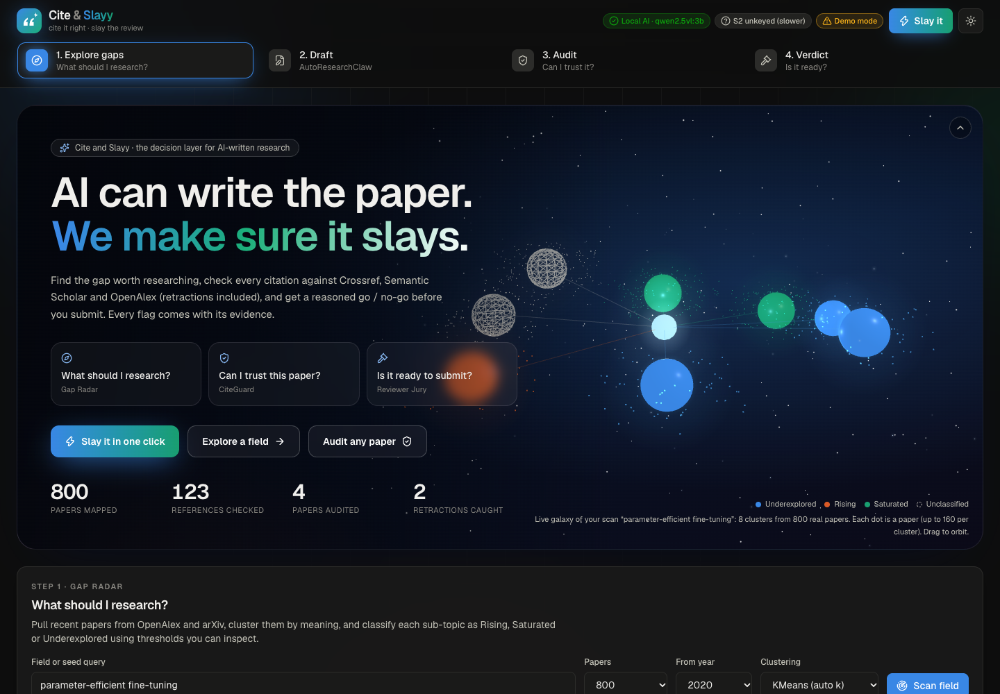

</div>

---

## 🎬 Watch it work

<p align="center">
  <a href="docs/media/citeslayy-demo.mp4"></a>
  <br /><sub><b>The 23-second tour.</b> Click it for the MP4 with sound.</sub>
</p>

<p align="center">
  <a href="docs/media/citeslayy-reel.mp4">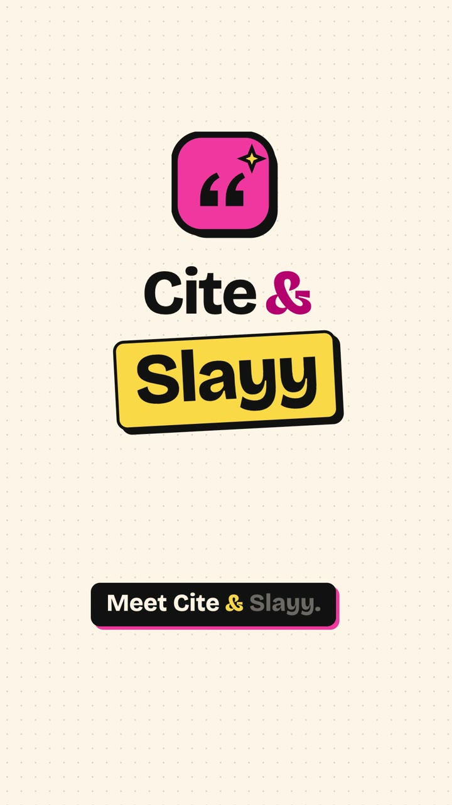</a>
  <br /><sub><b>▶ The 1-minute reel</b> (vertical, with sound): Gap Radar, Paper Studio, CiteGuard, the Reviewer Jury and the venue finder.</sub>
</p>

Both videos also play on the [landing page](https://citeslayy.com/#watch).

---

## The problem

AI can now draft a research paper in minutes. That's the easy part. What it can't do on its own is make that paper
**trustworthy**:

- language models invent references that look perfect and don't exist;
- real papers get retracted and keep collecting citations for years;
- a claim gets pinned to a source that never said it;
- reviewers reject papers for missing limitations, missing statistics, or the wrong venue.

Every one of those failures ends the same way: a desk reject, a retraction, or a reputation hit.

## The answer

**Cite & Slayy is the decision layer around AI-written research.** It answers the four questions every researcher has,
with evidence you can click:

| | Question | Module | What happens |
|---|---|---|---|
| 🧭 | **What should I research?** | Gap Radar | Clusters up to 2,000 real papers, measures growth and attention, and labels each sub-field *Rising*, *Saturated* or *Underexplored* |
| ✍️ | **Write it for me** | Paper Studio | A team of 14 AI agents writes a full paper with **only real references**, measured figures, equations, diagrams and a planned evaluation |
| 🛡️ | **Can I trust it?** | CiteGuard | Checks every reference exists, catches retractions (including of the paper itself), tests claim support, tortured phrases and overlap |
| ⚖️ | **Is it ready, and where?** | Reviewer Jury + Venue finder | Four expert reviewer personas plus deterministic rules decide *Submit / Revise / Don't submit*, with a ranked fix list and real venues |

> **The rule we never break:** nothing is invented. Every reference is a real record with a DOI or URL. Every number is
> measured or comes from a cited abstract. When something can't be checked, the app says *could not verify*, never a guess.

---

## 🤖 Agent Pay: AI agents pay for verified citations, with PayPal

> Built for the **PayPal AI Hackathon** (Nov 2026).

AI agents now write essays, legal briefs and papers, and they invent references. CiteGuard can catch that, but an
agent can't sign up for a plan, and nobody wants to give an agent an unlimited card. **Agent Pay** lets any AI agent
(Claude, Cursor, a custom bot) call CiteGuard as a paid tool and pay per reference from a **PayPal-funded wallet**,
inside spending rules its owner writes in plain English.

| | How it works |
|---|---|
| 🗣️ **Rules in plain English** | *"At most $20 a month, $2 per call, ask me before anything over $1, only my writer-bot."* An LLM compiles this into a mandate (caps, approval threshold, allowed agents, auto-reload). Every number is clamped to server ceilings, and the decision on each call is plain arithmetic: **the AI writes the rules, it never approves a payment.** |
| 💳 **PayPal wallet** | The owner tops up with PayPal Checkout (Orders v2). They can save their PayPal account (vault, *save during purchase*) so the wallet reloads itself when it runs low, only if the rules allow it and never beyond the monthly cap. |
| 🛑 **Ask-first approvals** | A call over the threshold returns `402 needs_approval` with a request id. The owner approves in the dashboard; the agent retries with the same request id. Approvals are single-use and bound to the exact references. |
| 🧾 **Pay for answers, not attempts** | The wallet is debited before the check (so parallel calls can't double-spend). References we couldn't settle because a database was down are credited straight back. |
| ↩️ **Refund to PayPal** | Unused balance goes back to the owner's PayPal account (Payments v2 refunds), split across the original captures. |
| 📊 **Audit log** | Every top-up, charge, credit, block, approval and refund is a ledger row, shown in an **AG Grid** table with PayPal references, plus an AI summary: *"Explain my agents' spending"*. |
| 🔌 **MCP tool** | [`mcp/citeslayy_mcp.py`](mcp/citeslayy_mcp.py) (standard-library Python) exposes `verify_references`, `quote_verification` and `check_approval` to any MCP client. |

**PayPal APIs used:** OAuth 2.0 client credentials · Orders v2 (create, get, capture) · vaulted PayPal wallet
(save during purchase, merchant-initiated charges with `vault_id`) · Payments v2 refunds · webhook signature
verification (`PAYMENT.CAPTURE.COMPLETED`) · PayPal JS SDK Smart Buttons. PayPal is also a **USD checkout for plans
and the Paper Pack** next to Razorpay (INR). Buyers can also pay through **[PayPal.me](https://paypal.me/slayaliza)** and submit the
transaction ID; the owner approves it in *Payments & members*.

**AI used:** an LLM (Amazon Bedrock: Claude / Kimi, or OpenAI, Gemini, local Ollama; see `LLM_PROVIDER`) compiles
spending rules into a typed mandate (JSON schema output) and writes the spending summary. CiteGuard itself checks every
reference against Crossref, arXiv, Semantic Scholar and OpenAlex, plus retraction notices. With no LLM configured, an
offline rules parser compiles the common phrasings so the demo still runs.

### Run Agent Pay locally (PayPal sandbox)

1. Create a sandbox app at [developer.paypal.com](https://developer.paypal.com) → *Apps & Credentials*. Turn on
   **Save payment methods** if you want auto-reload. Copy the client id and secret.
2. In `.env`: `PAYPAL_CLIENT_ID=…`, `PAYPAL_CLIENT_SECRET=…`, `PAYPAL_ENV=sandbox` (plus the usual Quick start settings below).
3. Start the API and the web app (see Quick start), open `http://localhost:3000/app?tab=agentpay`.
4. Write your rules → **Save rules**. Top up $10 with PayPal using a **sandbox personal account** (*Sandbox → Accounts*).
5. **Create key** → **Run agent call**. Try a made-up reference to watch it get flagged, or more than 20 references to trigger the approval flow.
6. Connect a real agent. Claude Code:
   ```bash
   claude mcp add citeguard -e CITESLAYY_AGENT_KEY=csk_... -e CITESLAYY_API_URL=http://localhost:8000 -- python3 mcp/citeslayy_mcp.py
   ```
   Then ask Claude: *"Verify the references in my draft with CiteGuard."*

The raw API, for any agent framework:

```bash
curl -X POST http://localhost:8000/api/agent/v1/verify \
  -H "Authorization: Bearer csk_..." -H "content-type: application/json" \
  -d '{"references": ["Vaswani, A., et al. Attention is all you need. NeurIPS 2017."]}'
```

Answers: `200` with per-reference results and the charge · `402 needs_approval` (with `request_id`) ·
`402 insufficient_funds` · `403 denied` (with the rule that blocked it).

Code: [`backend/payments/paypal.py`](backend/payments/paypal.py) (PayPal client) ·
[`backend/agentpay/`](backend/agentpay) (mandate, wallet, paid service, routes) ·
[`backend/accounts/paypal_billing.py`](backend/accounts/paypal_billing.py) (plans) ·
[`frontend/components/agentpay/`](frontend/components/agentpay) (dashboard, PayPal buttons, AG Grid ledger) ·
[`tests/test_agentpay.py`](tests/test_agentpay.py) (fake PayPal sandbox: top-ups, rules, approvals, auto-reload, refunds).

---

## 📸 A tour

<table>
<tr>
<td width="50%">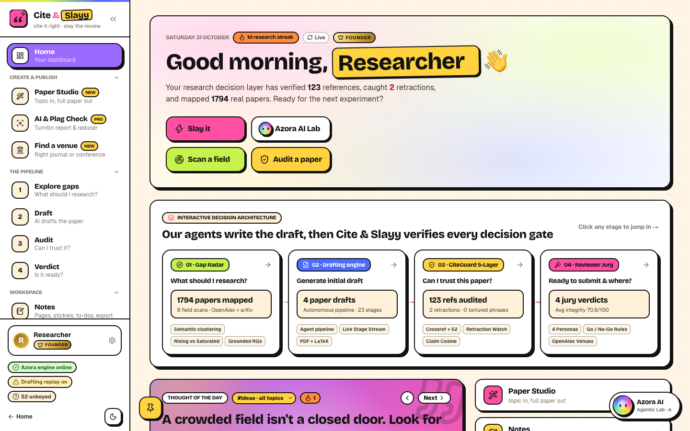<br/><b>Home:</b> the decision pipeline, live research telemetry, activity heatmap and your membership badge.</td>
<td width="50%">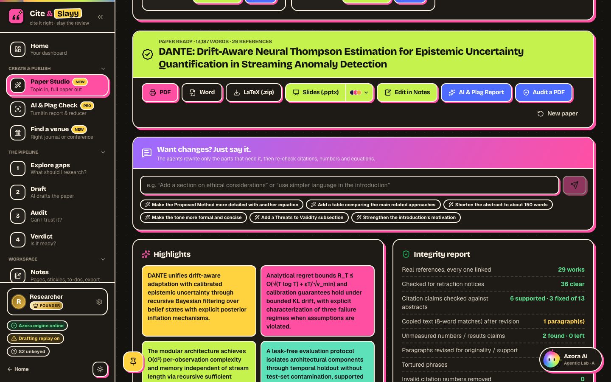<br/><b>Paper Studio:</b> a finished 13,000-word paper with highlights, an integrity report, revise-by-chat, Word / LaTeX / PDF and 16-slide decks.</td>
</tr>
<tr>
<td>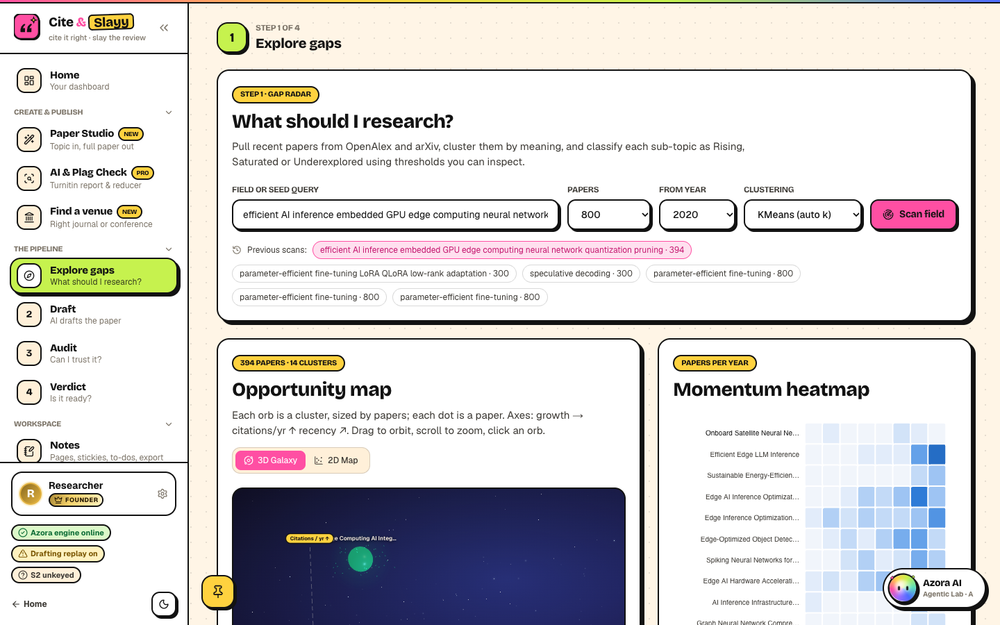<br/><b>Gap Radar:</b> a 3D research galaxy and momentum heatmap built from a real OpenAlex + arXiv scan.</td>
<td>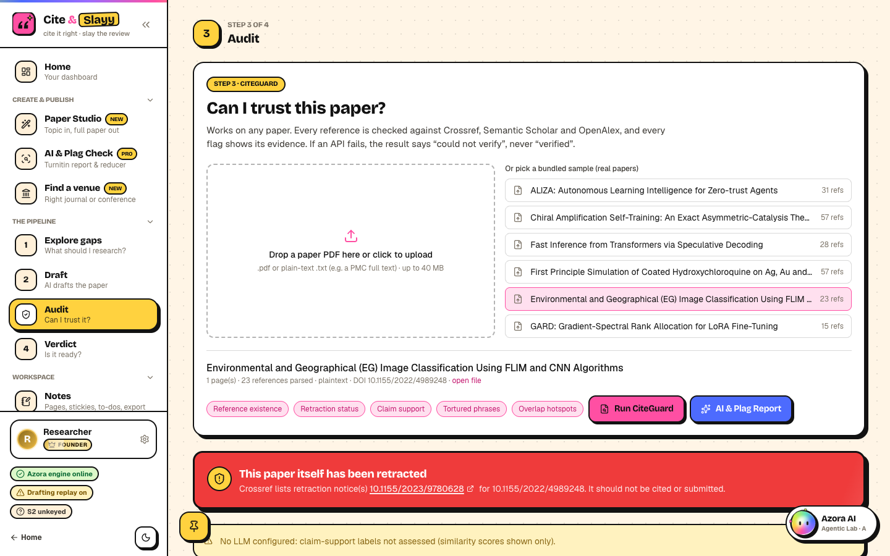<br/><b>CiteGuard:</b> catches that this paper <i>itself</i> was retracted, with the Crossref notice linked.</td>
</tr>
<tr>
<td>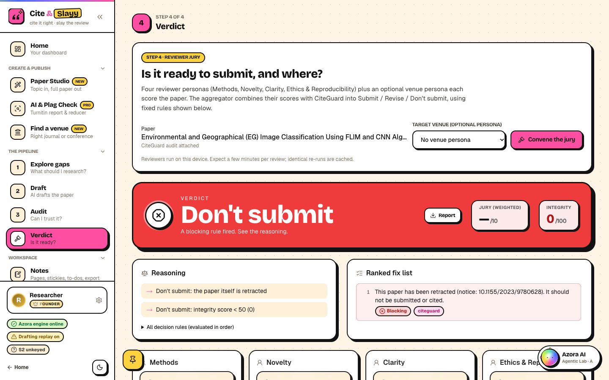<br/><b>Reviewer Jury:</b> <i>Don't submit</i>, with the exact rule that fired and a ranked fix list.</td>
<td>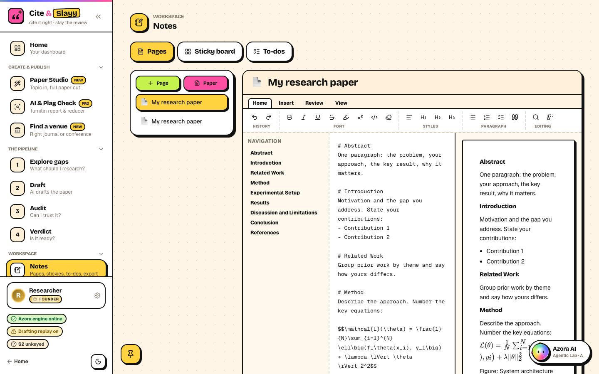<br/><b>Notes:</b> a Word-style ribbon over Markdown with a navigation pane, live preview, KaTeX and an Overleaf-style LaTeX view.</td>
</tr>
<tr>
<td>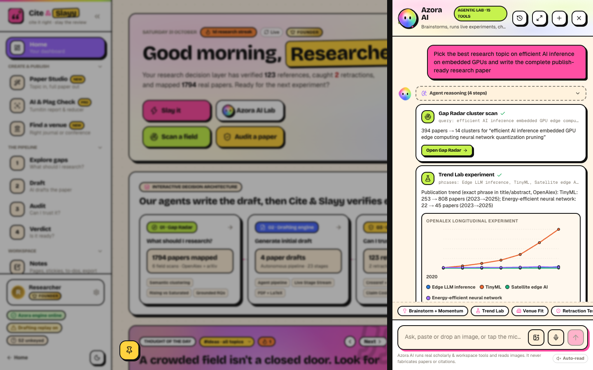<br/><b>Azora AI:</b> an agent that runs real experiments (trend lab, cluster scans, claim tests) and reads images and voice.</td>
<td>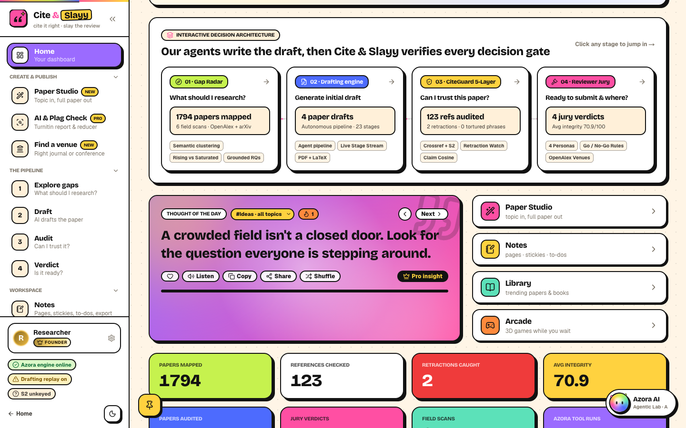<br/><b>Thought of the Day:</b> a 3D-tilting, swipeable card with read-aloud, share, streaks and a Pro insight.</td>
</tr>
<tr>
<td>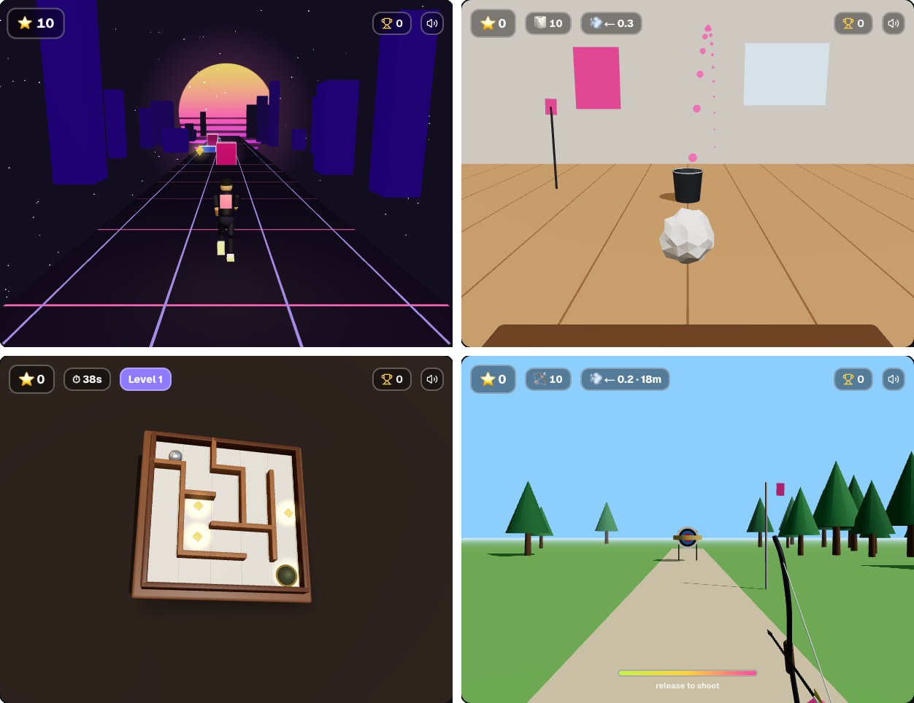<br/><b>Arcade:</b> eight physics-based 3D games to play while a paper generates.</td>
<td>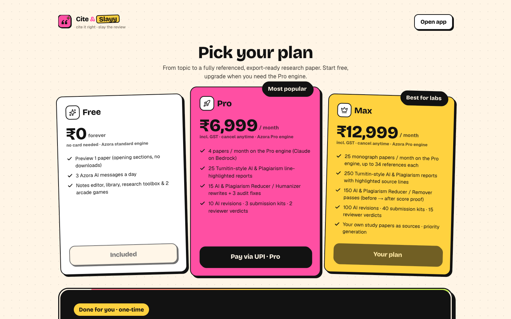<br/><b>Plans:</b> a free preview, Pro and Max, with UPI and Razorpay checkout.</td>
</tr>
</table>

<p align="center">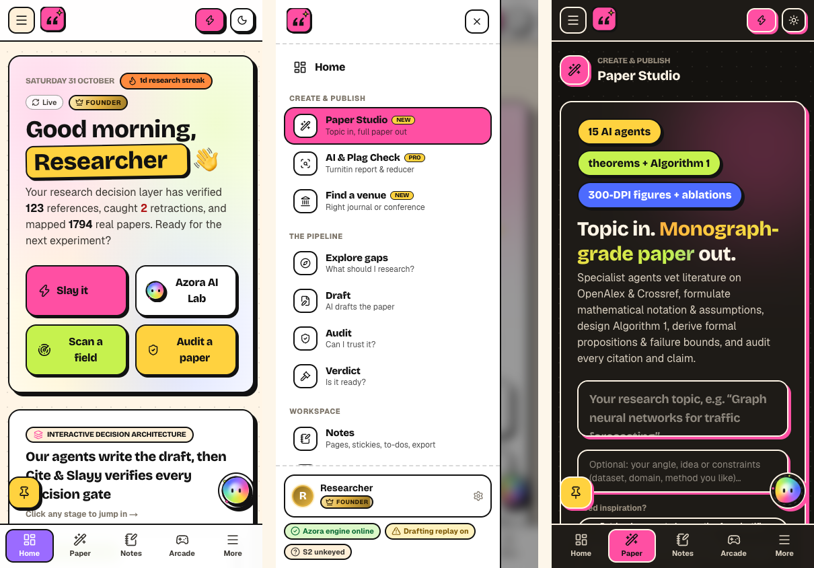<br/><b>Mobile:</b> menu drawer, 5-item bottom bar, no sideways scrolling at 390 px.</p>

---

## ✨ What it does

### ✍️ Paper Studio: a research team that plans, writes, reviews and verifies

Type a topic. The team researches it, shows you the plan, then writes the paper your field expects: a **technical method
paper**, an **empirical study**, a **literature review** or a **position paper**. Every stage streams live.

```mermaid
flowchart LR
  T([Topic + angle<br/>optional PDFs, CSV, target venue]) --> S[🔭 Scout<br/>OpenAlex · Semantic Scholar · arXiv<br/>picks the paper type]
  S --> L[📚 Librarian<br/>citation chaining · S2 recommendations<br/>influence data · retraction screen]
  L --> R[🗣️ Expert roundtable<br/>4 perspectives question the corpus<br/>conflicting evidence extracted]
  R --> D[🗂️ Dossier + Architect<br/>best-of-N title & question<br/>novelty check · venue style]
  D --> P{{👀 You review the plan}}
  P --> W[✍️ Writers in dependency order<br/>shared paper memory]
  W --> E[🖋️ Consistency editor]
  E --> RV[⚖️ 3-reviewer panel<br/>2 rounds of revision]
  RV --> V[🛡️ Verifier ×2<br/>every citation vs abstract + full text<br/>gap filling · numbers · LaTeX]
  V --> F[🖼️ Figure check · best-of-3 abstract]
  F --> OUT([📄 Paper · click any citation to see its source])
```

| Stage | What it does |
|---|---|
| **Scout** | Plans searches, chooses the paper type, searches OpenAlex, Semantic Scholar and arXiv |
| **Librarian** | Adds works cited by several of the most relevant papers (citation chaining) and Semantic Scholar recommendations; picks the reference list with quotas for seminal (by *influential* citations) and recent work; screens Crossref retractions |
| **Expert roundtable** | Four experts chosen for the topic question the literature from their angle; findings that contradict each other are extracted as explicit conflicts |
| **Dossier & architect** | A grounded 2-3k-word research dossier, an outline for the paper type, the best title and research question from several candidates, a target-venue style card |
| **Novelty check** | Searches for prior work that already does the proposal; if found, cites it and repositions the contribution |
| **Your review (co-pilot)** | Edit the title, question, contributions, section briefs and sources, or add instructions, before writing starts |
| **Writers** | Foundations first, Introduction last, all sharing a paper memory of terms and points already made; content checklists instead of word counts |
| **Your data** | Upload a CSV and vetted statistics run in code (t-tests, ANOVA, correlation, OLS, chi-square, Holm correction): the paper reports real results |
| **Simulation study** | For method papers: the proposed method vs baselines over 5 seeds, an ablation and a stress sweep, executed in a sandbox |
| **Consistency editor & reviewer panel** | Whole-paper edits for repetition and terminology; three reviewers on different model families score the draft and the flagged sections are revised, twice |
| **Verifier** | Every cited sentence is judged against each cited abstract, and against the paper's **full text** (Semantic Scholar snippets) when the abstract can't settle it; claims that still lack evidence get a new search; unmeasured numbers, copied text, LaTeX and diagrams are checked; a second pass re-checks the revised text |
| **Figures & abstract** | A vision model checks each figure against its caption; three candidate abstracts, the best one chosen |

**Measured, not claimed.** `scripts/paper_bench.py` writes papers on fixed topics and scores them the same way every
release (3-reviewer panel averaged over two runs, every citation checked with full text):

| Version | Reviewer panel (1-10) | Citation support | Cost / paper |
|---|---|---|---|
| Before this pipeline | 3.7 | 63% | $0.87 |
| Paper types, dossier, reviewer panel, full claim checks | 4.95 | 83% | $1.49 |
| + strongest model for writing, simulation studies, second review round | **5.44** | 82% | $2.02 |

A second verification pass over the revised text then cut unsupported citations from 12 to 5 on the sleep-study topic
(panel 5.5, about $2.30 per paper).

**Honest by construction.** Work that was not run is written as a design, hypothesis or protocol, never as a result;
tables with unmeasured numbers are removed; every number traces to a measurement listed under *Where the numbers come
from*. Papers carry an AI-assistance acknowledgment and the integrity report is shown next to the paper.

**After the paper:**

- **Revise by chat:** *"shorten the abstract to 150 words"*, *"add a threats-to-validity section"*. The agents re-plan only the affected sections, keep the same references, re-verify and keep an undo history.
- **Exports:** PDF, Word (figures embedded) and a LaTeX `.zip` (`main.tex` + `figures/`) in IEEE, Springer LNCS or plain format, or one click to Overleaf.
- **16-slide presentations:** native PowerPoint charts from the measured data, the architecture redrawn as shapes, the evaluation table and speaker notes. Six built-in themes, or the colours of any of **530+ free designs** from the [ppttemplate.ai catalogue](https://github.com/ai-ppt-template/free-ppt-template) (CC BY 4.0).
- **Submission kit:** cover letter, declarations, a computed pre-submission checklist, reviewer suggestions drawn from cited authors, and a response-to-reviewers template.
- **Journal & conference finder:** ranks venues by where the most similar recent papers were published, with open-access, APC and impact facts from OpenAlex.

### 🛡️ CiteGuard: five checks, every flag with evidence

| # | Check | How it works |
|---|---|---|
| 1 | **Does the reference exist?** | Crossref DOI → Crossref bibliographic search → arXiv → Semantic Scholar → OpenAlex. A hit whose year *and* first author both disagree is treated as a different paper |
| 2 | **Is it retracted?** | Crossref `updated-by` plus `filter=updates:{doi}` on every matched version, preprint and journal alike. The uploaded paper itself is checked too |
| 3 | **Does the source say what you claim?** | Citing sentence vs. cited abstract: embedding cosine plus an LLM judgment. No abstract means *Unclear*, never *Unsupported* |
| 4 | **Tortured phrases** | A sourced list from Cabanac et al. (2021), tolerant of line breaks, hyphenation and plurals |
| 5 | **Overlap hotspots** | Paragraph embeddings vs. cited and related abstracts, labelled *possible overlap*, never "plagiarism" |

Every flag links the exact API request, the matched record and the fields that matched.

### ⚖️ Reviewer Jury

A deterministic checklist reviewer (abstract, limitations, data availability, ethics, statistics, reproducibility,
figures, reference recency) plus **Methods, Novelty, Clarity and Ethics** personas, and an optional venue persona.
Every persona returns validated JSON with a score, weaknesses, fixes and a confidence. Invalid output is retried once and
then reported as *Not assessed*, never coerced.

### 🧭 Gap Radar

Up to 2,000 papers from OpenAlex and arXiv are embedded, clustered and labelled, then classified relative to the field's
own medians (formulas below). Research questions must cite papers by number from a supplied list; any question citing
an unknown number is dropped, and the UI says how many.

### 🤖 Azora AI: an agent that runs experiments

Azora is a tool-using agent with **16 real tools**. It doesn't just talk about research; it runs it:

| Research | Integrity | Workspace |
|---|---|---|
| `search_papers` · `scan_field` · `research_questions` · `trend_experiment` · `venue_fit_experiment` · `write_paper` | `check_citation` · `check_retraction` · `test_claim` · `text_integrity_test` · `audit_paper` · `review_paper` · `list_papers` | `save_note` · `pin_stickies` · `add_todos` |

Attach, paste or drop images (read by a vision model), dictate with the microphone, and have answers read aloud.
Results render as live charts, paper lists and links that jump straight into the app.

### 📝 A writing workspace that feels like Word and Overleaf

- **Ribbon editor:** formatting shortcuts, headings, lists, checklists, tables (size picker), an equation gallery, symbols, picture upload, flowcharts, footnotes, find & replace, navigation pane, focus mode, zoom and version history.
- **Cite by DOI:** paste a DOI and it's looked up on Crossref and added to your References as a numbered IEEE entry.
- **Live LaTeX view:** your page compiles to IEEE, Springer or plain LaTeX as you type; open it in Overleaf in one click.
- **Sticky board, to-dos with AI breakdown, a Pomodoro timer,** and 📌 pins you can drop on any screen.
- **Read aloud and dictation** using the browser's own speech engines.

### 🎮 Arcade: eight 3D games with real physics

| Game | Highlights |
|---|---|
| **Paper Toss** | Drag-to-aim with a gravity-only preview arc; a fan's wind drifts the ball; rim bounces; swish and distance bonuses |
| **Archery Range** | A recurve bow with a drawn string; arrows drop and drift with wind and wobble when they stick; ten-ring scoring |
| **Mini Golf** | Six holes, slingshot putting, rails, spinning bars, and a cup that lips out if you're too fast |
| **Neon Runner** | An articulated, animated runner on a synthwave track |
| **Tilt Maze** | Walnut board and chrome ball with sub-stepped collision physics |
| **Ring Flyer · Bubble Pop · Meteor Shield** | Fly, pop and defend |

Plus three research games: *Tortured Phrase Quiz*, *Acronym Memory* and *Catch the Retraction*.

### 👑 Membership, badges and the 3D pass

Every account gets a **tier badge** (Founder, Max, Pro, Paper Pack) and a physics-driven **3D lanyard pass** in its profile:
matte for Free, holographic for Pro and Max, metallic gold for founders. Drag it, swing it, tap or swipe to flip it.

---

## 🏗 Architecture

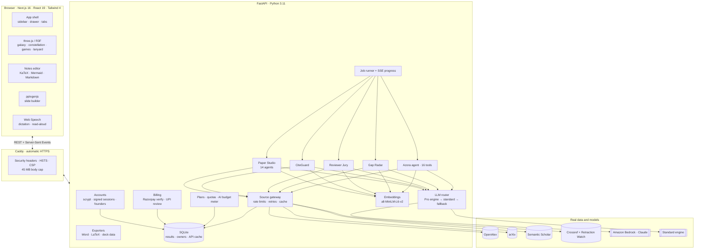

**Design decisions that matter:**

- **One gateway to the outside world.** `backend/sources/http.py` is the only code that calls scholarly APIs: per-source rate limits, retries with back-off, and a timestamped SQLite cache that stores only real responses, never errors.
- **Everything slow is a job.** Every long operation returns a `job_id`; the UI follows a Server-Sent Events stream, so progress bars reflect real work.
- **The model never holds the pen alone.** Every model output is validated against a schema, and numbers, references, tables and diagrams are checked in code before you see them.
- **Margins are enforced in code.** Every model call is metered against the user's monthly AI budget.

### The decision pipeline

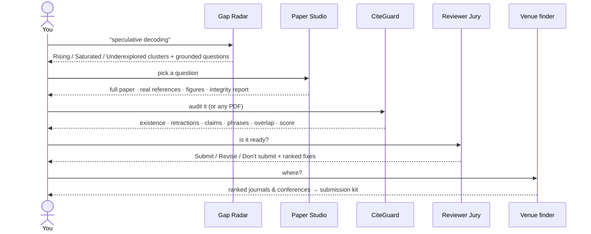

Or press **S** for **Slay it**: audit and verdict for any paper as one job.

---

## 🧮 The maths behind the decisions

Every score is shown in the UI with its formula and inputs. Nothing is a black box.

### Gap Radar

For a cluster with paper counts $n_y$ per year over the last three complete years:

$$\text{growth} = \left(\frac{n_{y_3}+1}{n_{y_1}+1}\right)^{1/2} - 1 \qquad \text{recency} = \frac{\text{papers in the last 12 months}}{\text{papers in cluster}} \qquad \text{cites/yr} = \frac{1}{|C|}\sum_{p\in C}\frac{\text{citations}_p}{\max(1,\ \text{age}_p)}$$

Clusters come from KMeans with $k \in [6, 15]$ chosen by silhouette score. Classification is relative to the field's own medians:

| Class | Rule |
|---|---|
| **Rising** | growth ≥ 1.5 × median growth **and** recency ≥ median recency |
| **Underexplored** | size in the bottom third **and** cites/yr > median |
| **Saturated** | size in the top third **and** growth ≤ median |
| **Unclassified** | none of the above (never forced into a box) |

### CiteGuard integrity score (0–100)

$$R = 40\cdot\frac{v + 0.5\,m}{v+m+f} \quad C = 30\cdot\frac{s + 0.5\,u}{a} \quad P = 15\cdot\max\!\left(0,\ 1-\frac{h}{3}\right) \quad O = 15\cdot\left(1-\frac{o}{N}\right)$$

$$\text{score} = 100\cdot\frac{\sum \text{available terms}}{\sum \text{their maxima}} \;-\; 15\cdot(\text{retracted citations}), \qquad \text{score}=0 \text{ if the paper itself is retracted}$$

where $v$ = verified, $m$ = metadata mismatch, $f$ = not found (*could not verify* excluded), $s$ = supported, $u$ = unclear,
$a$ = assessed claims, $h$ = tortured-phrase hits, $o$ = flagged paragraphs out of $N$. Checks that couldn't run are
**excluded**, not counted as passes.

Overlap is flagged when a paragraph's embedding is close to a cited or related abstract:
$\cos(\mathbf{e}_{\text{para}}, \mathbf{e}_{\text{abstract}}) \ge 0.85$.

### Reviewer Jury verdict

$$\bar{s} = \frac{\sum_i \text{score}_i \cdot \text{confidence}_i}{\sum_i \text{confidence}_i} \qquad \text{checklist} = 1 + 9\cdot\frac{\text{passed}}{\text{total}}$$

| Decision | When (evaluated in order) |
|---|---|
| **Don't submit** | paper itself retracted · ≥ 3 references not found · integrity < 50 · $\bar{s}$ < 5 |
| **Revise** (floor) | any reference not found or any cited work retracted |
| **Submit** | $\bar{s}$ ≥ 7 **and** every persona ≥ 5 **and** integrity ≥ 80 **and** no floor rule |
| **Revise** | otherwise |

Fixes are ranked blocking-first, then by $(10-\text{score})\times\text{confidence}$, with near-duplicates merged by embedding similarity.

### Unit economics, enforced per call

$$\text{AI spend}_u = \sum_{\text{calls}} \left(t_{\text{in}}\cdot p_{\text{in}} + t_{\text{out}}\cdot p_{\text{out}}\right)\cdot \text{FX}_{\text{USD→INR}} \;\le\; B_{\text{plan}}$$

Each plan carries a monthly budget $B$ (Pro ₹900, Max ₹4,000). When it's spent, model-backed features pause. That keeps the
contribution margin at roughly **63–84%** after GST and gateway fees, even at full use. Failed jobs refund their quota automatically.

### Game physics (because why not)

- **Paper Toss:** launch velocity $\mathbf{v} = v\,(\cos\theta\sin\psi,\ \sin\theta,\ -\cos\theta\cos\psi)$ with $v = 3.6 + 5.2p$, $\theta = 0.86$ rad; integrated with gravity, wind and drag in 4 sub-steps; rim collisions reflect along the contact normal.
- **Tilt Maze:** $\dot{\mathbf{v}} = g\,(-\sin\phi_z,\ \sin\phi_x)$ with speed capped at 5.5 and $\lceil |v|\Delta t / 0.04 \rceil$ sub-steps, so the ball never moves further than a wall's thickness in one step.

---

## 💳 Plans, paywall and payments

| | Free | Pro · ₹6,999/mo | Max · ₹12,999/mo | Paper Pack · ₹9,999 once |
|---|---|---|---|---|
| Papers | 1 preview (opening sections) | 4 / month | 25 / month | 1 |
| Downloads (Word · LaTeX · PDF · Overleaf) | – | ✓ | ✓ | ✓ |
| Slide decks | – | 4 | 40 | 3 |
| AI revisions | – | 10 | 100 | 40 |
| CiteGuard audits · verdicts | – | 8 · 2 | 150 · 15 | 10 · 3 |
| AI & plagiarism similarity reports | – | 25 | 250 | 15 |
| Azora AI messages / day | 3 | 50 | 300 | – |
| Engine | Standard | Pro (Claude via Bedrock) | Pro | Pro |

The paywall is enforced **on the server**: a free user's paper is truncated before it leaves the API, and every paid
endpoint returns HTTP 402 with a feature-specific upgrade screen. Locked tools show a live, blurred preview.

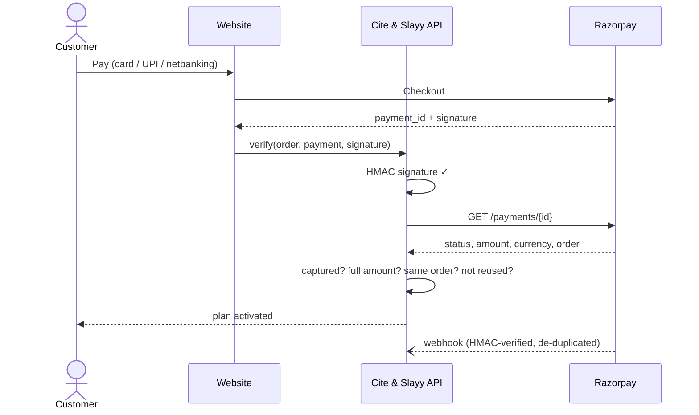

Without Razorpay, customers pay by **UPI** and submit the 12-digit UTR. A UTR can be claimed once, and nothing activates
until a founder matches it in the bank app and approves it on the **Owner → Payments** screen.

---

## 🔒 Security and production

| Layer | What protects you |
|---|---|
| **Transport** | HTTPS everywhere (Caddy + Let's Encrypt), HSTS |
| **Browser** | CSP (no framing, no plugins, form targets limited), `X-Frame-Options: DENY`, `nosniff`, strict referrer policy, permissions policy (microphone and payment for this site only) |
| **Accounts** | scrypt password hashes, constant-time comparison, per-IP and per-email rate limits with lockout, generic error messages, HttpOnly + SameSite + Secure session cookies, session revocation on password change |
| **Founders** | Admin accounts defined only by password hashes in a server-side file; re-asserted on every start; any other owner rights are revoked |
| **Data** | Every object is owned; every read checks ownership; lists show only your own items |
| **Abuse** | Server-side quotas and AI budgets, rate limits on sign-up, login, uploads, images and payment claims; uploads are read only up to their size cap |
| **Payments** | Signature **and** server-to-server confirmation of amount, currency, order and owner; payment and webhook replay protection; human review for UPI |
| **Content** | No raw HTML in Markdown, Mermaid in strict mode, image uploads allow-listed (no SVG), outbound fetches limited to known hosts |
| **Ops** | No SSH: deploys go through AWS Systems Manager; secrets live only in gitignored files on the server |

---

## 🧰 Tech stack

| Layer | Technology |
|---|---|
| **Frontend** | Next.js 16 · React 19 · TypeScript · Tailwind CSS 4 · Motion · lucide-react |
| **3D** | three.js 0.187 · React Three Fiber · drei · React Bits *Lanyard* |
| **Charts & docs** | ECharts 6 · Mermaid 12 · KaTeX · react-markdown · pptxgenjs · QR codes |
| **Backend** | FastAPI · Pydantic 2 · httpx · Server-Sent Events · SQLite |
| **Documents** | PyMuPDF · python-docx · matplotlib · Pillow |
| **ML / NLP** | sentence-transformers (all-MiniLM-L6-v2) · scikit-learn (KMeans, silhouette) · RapidFuzz |
| **LLMs** | Anthropic SDK on Amazon Bedrock (Claude, Pro engine) · OpenAI-compatible and Gemini clients · local Ollama |
| **Scholarly data** | OpenAlex · arXiv · Semantic Scholar · Crossref (incl. Retraction Watch) |
| **Auth & payments** | scrypt · HMAC-signed sessions · google-auth · Razorpay · UPI |
| **Infra** | AWS EC2 · Elastic IP · S3 · Systems Manager · Docker Compose · Caddy · GoDaddy DNS |
| **Quality** | pytest (89 tests) · ESLint · TypeScript strict · headless-Chrome visual QA |

---

## 🚫 The "never fabricate" guarantees

| Rule | Where it's enforced |
|---|---|
| Every citation check hits a real API | `sources/` is the only network layer; the cache stores only real responses with their fetch time |
| An API failure is never "verified" or "not found" | *not found* requires every resolver to answer; any failure without a match is *could not verify* |
| Every flag shows its evidence | Each flag carries the request URL, a human-readable record link and the matched fields |
| The model can't invent sources | It may only cite numbered papers we supplied; unknown numbers are dropped |
| The model can't invent results | Unmeasured numbers and results tables are detected and removed; evaluations read *to be measured* |
| Missing stays missing | No abstract → *Unclear*. No model → *Not assessed*. No Crossref DOI → *Not covered* |

---

## 🚀 Quick start

**You need:** [uv](https://docs.astral.sh/uv/) (installs Python 3.11), Node.js 20+, and internet access.

```bash
git clone https://github.com/batmandevx/Cite-and-slayy.git && cd Cite-and-slayy
cp .env.example .env                    # optional: API keys and CONTACT_EMAIL
uv sync                                 # Python deps (first run downloads torch, ~2 min)
cd frontend && npm install && cd ..
./scripts/dev.sh                        # backend :8000 + frontend :3000
```

Open <http://localhost:3000>. Locally, login is off and you are a single owner account with every feature unlocked.
No API key? Run `ollama pull qwen3.5:9b && ollama serve` and Cite & Slayy uses the free local model automatically.

<details>
<summary><b>Environment variables</b></summary>

| Variable | Purpose |
|---|---|
| `LLM_PROVIDER`, `LLM_MODEL` | `auto` prefers local Ollama, then the first cloud key found |
| `PREMIUM_MODEL`, `BEDROCK_REGION` | The Pro engine for paid plans (Claude on Amazon Bedrock) |
| `ANTHROPIC_API_KEY` / `OPENAI_API_KEY` / `GEMINI_API_KEY` | Cloud providers |
| `CONTACT_EMAIL`, `S2_API_KEY`, `OPENALEX_API_KEY` | Polite pools and higher rate limits for scholarly APIs |
| `AUTH_REQUIRED`, `PUBLIC_URL` | Production accounts; cookie `Secure` flag and email links |
| `FOUNDER_ACCOUNTS`, `FOUNDER_NAMES` | Founder logins as scrypt hashes (base64url JSON) and display names |
| `RAZORPAY_KEY_ID`, `RAZORPAY_KEY_SECRET`, `RAZORPAY_WEBHOOK_SECRET` | Card / netbanking checkout |
| `GOOGLE_CLIENT_ID`, `SMTP_*` | Optional Google sign-in and magic-link email |
| `SUPPORT_EMAIL` | Contact address shown across the site |
| `DEMO_MODE`, `AUTOCLAW_*` | Founder-only drafting replay / live AutoResearchClaw runs |

</details>

<details>
<summary><b>Deploy to AWS</b></summary>

```bash
./scripts/aws_deploy.sh up      # instance, security group, Elastic IP, SSM role
./scripts/aws_deploy.sh push    # ship the current code
```

Production settings go in `.env.production` (gitignored), which is merged into the server's `.env.server` on each push.
Set `DOMAIN=yourdomain.com` in `.aws-deploy.env` and point an A record at the instance; Caddy fetches and renews the certificate.

</details>

<details>
<summary><b>API reference</b></summary>

All long operations return `{ "job_id" }`; follow `GET /api/jobs/{id}/events` for live progress.

| Area | Endpoints |
|---|---|
| Accounts | `POST /api/auth/register` · `/login` · `/logout` · `GET /api/auth/me` · `POST /api/account/profile` · `/password` · `/logout-all` |
| Paper Studio | `POST /api/paper-studio` · `GET /api/paper-studio/{id}` · `POST …/{id}/revise` · `/undo` · `/kit` · `/deck` · `GET …/fig/{name}.png` |
| Integrity | `POST /api/documents` · `POST /api/citeguard/audits` · `POST /api/jury/reviews` · `POST /api/pipeline` · `POST /api/originality/scan` |
| Discovery | `POST /api/gap-radar/runs` · `POST /api/venues/find` · `GET /api/library/{trending,latest,books}` |
| Azora AI | `POST /api/agent/chat` (`{message, chat_id?, images?}`) · `GET /api/agent/chats` |
| Workspace | `GET/PUT /api/workspace/{pages,stickies,todos,pins}` · `POST /api/workspace/images` |
| Slides | `GET /api/deck-templates` · `GET /api/deck-templates/{slug}/palette` |
| Exports | `POST /api/export/docx` · `/latex` · `/latex-zip` |
| Billing | `GET /api/billing/plans` · `POST /api/billing/{upi-claim,subscribe,verify,pack,pack/verify,cancel,webhook}` |
| Owner | `GET /api/admin/upi-claims` · `POST /api/admin/upi-claims/{id}/{approve,reject}` |

</details>

---

## 🧪 Testing

```bash
uv run pytest -m "not live"     # 123 offline tests
uv run pytest -m live           # 3 tests against real public records
```

The suite covers parsing and reference matching, verdict rules, Paper Studio guards (fabricated tables, unmeasured numbers,
diagram grammar, overlap), slide extraction, sessions and revocation, password rules and lockout, founder seeding (including a
squatted email), the free preview and every paid gate, notes-image privacy, UPI claims, and Razorpay verification against a
mocked API (underpayment, someone else's subscription, replayed webhooks). The live tests assert real Crossref retraction
notices and that all 15 references of a showcase paper exist.

---

## ⚠️ Honest limitations

- Retraction coverage is Crossref's; works without a Crossref DOI are reported *Not covered*, not clean.
- The overlap threshold (0.85) was calibrated on a small set of papers. Treat hits as pointers for a human, not a verdict.
- Live AutoResearchClaw runs need its CLI installed; in production the drafting replay is a founder-only tool and users write papers in Paper Studio.
- Google sign-in shows *coming soon* until a client ID is configured; email and password is the production login.
- Jobs run in-process: a restart drops running jobs, but finished results persist.
- 3D features need WebGL.

---

## 📁 Project structure

```
cite-and-slayy/
├─ backend/
│  ├─ app/            FastAPI routes · jobs + SSE · exporters · venue finder · demo papers
│  ├─ accounts/       auth (sessions, passwords, founders, quotas) · plans · billing (Razorpay)
│  ├─ paper_studio/   planner, dossier, writers, reviewer panel, verifier · data analysis · slides · submission kit
│  ├─ agent/          Azora AI agent and its 16 tools
│  ├─ citeguard/      resolver · claims · phrases · overlap · score · audit · fixer
│  ├─ jury/           personas · venues · verdict
│  ├─ gap_radar/      ingest · embed · cluster · classify · questions
│  ├─ sources/        rate-limited, cached gateway to OpenAlex · arXiv · Semantic Scholar · Crossref
│  ├─ llm/            routed client with cost metering · embeddings · documents · cache
├─ frontend/          Next.js app · components (tabs, games3d, notes, billing, aurora) · lib (deck, export, api)
├─ deploy/            Dockerfiles · docker-compose · Caddyfile template
├─ scripts/           dev.sh · aws_deploy.sh · CLI tools
├─ data/ · demo/      tortured-phrase list · sample and showcase papers
└─ tests/             89 tests
```

---

## 🙏 Credits

- **[AutoResearchClaw](https://github.com/aiming-lab/AutoResearchClaw)** (MIT, AIMING Lab) is an external dependency called as a CLI; none of its code is copied. Its public showcase paper *GARD* is used, with attribution, as a demo.
- **Tortured phrases:** Cabanac, Labbé & Magazinov (2021), [arXiv:2107.06751](https://arxiv.org/abs/2107.06751).
- **Slide designs:** [ppttemplate.ai](https://github.com/ai-ppt-template/free-ppt-template) catalogue, CC BY 4.0.
- **Lanyard component:** [React Bits](https://reactbits.dev).
- **Data:** OpenAlex, arXiv, Semantic Scholar and Crossref, used through their free public APIs.
- Sample papers in `demo/` are openly licensed and remain under their original licences.

Built for the **GDGOC APU Hackathon** (*Data-Driven Research & Intelligent Decision Making*) by Ayush Upadhyay and team.
Questions or support: **slayyhacks@gmail.com**.

## License

Cite & Slayy's own code is MIT-licensed. Third-party components and data keep their own licences (see Credits).
