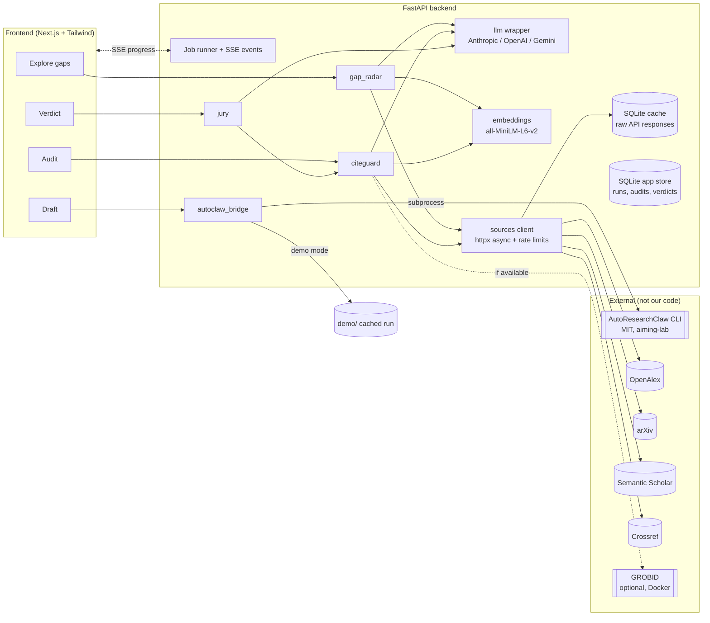

# Cite and Slayy: Milestone 1 Plan

> AutoClaw can write a paper. Cite and Slayy tells you whether you should write it, whether you can trust it, and whether it's ready.

Status: **implemented**. This was the Milestone 1 plan. See the [README](../README.md) for the built system, and §9 there for known limitations.

---

## 1. Architecture



**Flow:** Gap Radar picks a question, the bridge passes it to AutoClaw as `--topic`, the output PDF goes to CiteGuard, and the audit plus the PDF go to the Jury, which returns the verdict. Each tab also accepts its own input, so it works without the earlier steps.

### Cross-cutting design rules

| Rule | How it's enforced |
|---|---|
| Never fabricate | `sources/` is the only module that talks to external APIs. Every check result carries an `Evidence` object (source, request URL, matched fields, raw excerpt, `fetched_at`). No evidence means the status can't be "verified". |
| API failure ≠ negative result | Reference status `not_found` only when **all** resolvers answered successfully with no match. If any resolver errored and none matched, the status is `could_not_verify`. |
| LLM never invents sources | When the LLM must cite papers (Gap Radar questions), it only sees a numbered list of real papers. We validate the IDs it returns and drop any output that cites an ID not on the list. |
| Cache = real responses | SQLite stores raw HTTP bodies keyed by `sha256(method+url+params)` with `fetched_at`. Error responses are not cached, so a retry gets a fresh attempt. The UI shows "fetched at …" on evidence. |
| AutoClaw is external | Installed as a pinned dependency and invoked via subprocess. None of its code is in our packages. Credited in the README. |

---

## 2. Decisions I need you to confirm

1. **Frontend: Next.js (recommended) or Streamlit.**
   - *Why Next.js:* the demo depends on three things Streamlit does poorly: (a) side-by-side evidence panels with click-to-highlight in the paper text, (b) live SSE progress while AutoClaw/CiteGuard run, (c) a polished look for judges. The API contract below is frozen, so one frontend person can build against mock JSON from day one, in parallel with the backend.
   - *When Streamlit wins:* if nobody on the team is comfortable with React, or the hackathon is under ~24h. Then we'd lose polish but gain speed, and Streamlit would still call the same FastAPI endpoints (no shortcuts into Python modules) so we can swap later.
   - Charts: ECharts (`echarts-for-react`) for both the bubble chart and the heatmap.
   - Highlighted view: **highlighted extracted text with page anchors** is the baseline. Overlay on the rendered PDF (pdf.js text layer) is a stretch goal for M7.
2. **Python version.** This machine has Python 3.14; torch/sentence-transformers wheels can lag new Pythons. I'll use `uv` to pin **3.11** in a venv.
3. **GROBID.** Docker isn't installed here. Plan: **PyMuPDF + our own reference parser is the primary path**. GROBID is optional: if `GROBID_URL` is set we use it, because it links in-text citations to references much more reliably. If anyone can run Docker, it's worth it for check 3.
4. **Scope addition: self-status check.** The demo runs CiteGuard "on a known retracted paper". The retraction check as specified only looks at *cited* works, so a retracted paper with clean references would show nothing. I propose that CiteGuard also resolves **the uploaded paper itself** (DOI from the PDF, else a title match) and checks its retraction status. OK?
5. **LLM provider and keys.** Which provider do you have credits for? I'll default to whichever you name. The wrapper supports all three.
6. **Hackathon length and team size and skills.** These affect the task split in section 6.

---

## 3. Module design (key choices)

### 3.1 Gap Radar
- **Ingest:** OpenAlex `/works?search=…&filter=from_publication_date:…` with cursor paging (200/page, so ~5 to 10 requests for 1–2k papers). arXiv supplements recent preprints, respecting 1 request per 3 s. Dedupe by DOI, then arXiv ID, then normalized title. Abstracts come from OpenAlex's `abstract_inverted_index`, reconstructed.
- **Embed and cluster:** MiniLM on title + abstract. **KMeans with k chosen by silhouette in [6, 15]** is the default because results are predictable on stage. HDBSCAN (`sklearn.cluster.HDBSCAN`) is available behind a flag.
- **Label:** the LLM gets the 8 most central papers per cluster and returns a ≤6-word label plus a one-line description.
- **Metrics per cluster:** papers per year; growth = CAGR over the last 3 complete years; recency share = fraction from the last 12 months; **citations normalized by age** (cites / years since publication), so new clusters aren't penalized.
- **Classification:** relative to the field's own median, with thresholds returned in the API and shown in the UI:
  - **Rising:** growth ≥ 1.5 × field median growth AND recency share ≥ field median.
  - **Saturated:** size in the top tertile AND growth ≤ field median.
  - **Underexplored:** size in the bottom tertile AND age-normalized citations ≥ field median (strong interest, few papers).
  - **Unclassified:** anything else. Being honest about this beats forcing every cluster into one of three boxes.
- **Charts:** bubble chart with x = growth, y = age-normalized citations, size = paper count, color = class. Heatmap of cluster × year counts.
- **Research questions:** the LLM sees the cluster's top 15 papers plus the 2 nearest clusters' top 5. It returns 3 questions, each with `evidence_paper_ids`, which we validate against the provided list.
- **Send to AutoClaw:** a POST to the bridge with the question as `topic`.

### 3.2 AutoClaw bridge
- `ClawRunner` interface with two implementations: `LiveClawRunner` (subprocess `researchclaw run --topic … --mode co-pilot`, parses stdout lines into stage events, collects PDF/LaTeX from the output dir) and `DemoClawRunner` (replays `demo/autoclaw_run/` with timed stage events).
- **To verify in M6:** AutoResearchClaw's exact CLI flags, stage names in stdout, and output layout. I've taken the command from your brief and haven't checked it against the repo yet.

### 3.3 CiteGuard
**Parsing:** PyMuPDF text with page and bbox offsets. Reference section found by heading regex (References / Bibliography / Works Cited). Entries split by numbering or hanging-indent heuristics. Each entry is parsed for DOI, arXiv ID, title, year, and first-author surname. In-text citation markers (`[3]`, `[3–5]`, `(Smith et al., 2020)`) are linked to entries. With GROBID, we use its TEI output instead.

| # | Check | Method | Statuses |
|---|---|---|---|
| 1 | Reference existence | Crossref (DOI lookup, else `query.bibliographic`), then Semantic Scholar (arXiv ID / title match), then OpenAlex. Title match uses rapidfuzz `token_set_ratio ≥ 90`. Year allows ±1 (preprint vs. published). Authors compared on first-author surname. | Verified / Metadata mismatch (field-level diff shown) / Not found / Could not verify |
| 2 | Retraction / correction | Crossref: works whose `update-to` points at the cited DOI (`filter=updates:{doi}`), typed `retraction`, `correction`, `expression_of_concern`. The same check runs on the uploaded paper itself (decision 4). | Retracted / Corrected / EoC / None found / Could not verify |
| 3 | Claim–citation support | Citing sentence vs. cited abstract (S2, else OpenAlex). Cosine similarity plus an LLM judgment with a JSON schema. The LLM label wins, and similarity is shown alongside. **Missing abstract → Unclear (no abstract)**, never Unsupported. | Supported / Unclear / Unsupported |
| 4 | Tortured phrases | Exact plus lemmatized match against `data/tortured_phrases.csv` | hit list with page and offset |
| 5 | Overlap hotspots | Paragraph embeddings vs. abstracts of cited works plus top-10 related (S2 recommendations). Flag cos ≥ 0.85; the threshold gets tuned on the M2 test papers. | "Possible overlap", with the matched source shown |

**`tortured_phrases.csv` schema:** `tortured,expected,source,source_url,verified_by,added_at`. Seeded **only** with entries you verify. An `import_pps.py` script will map the Problematic Paper Screener export into the same schema later.

**Integrity score (0–100). Draft, to be finalized in M3:**
```
refs      = 40 × (verified + 0.5·mismatch) / checkable_refs     # could_not_verify excluded from the denominator
claims    = 30 × (supported + 0.5·unclear) / assessed_claims
phrases   = 15 × max(0, 1 − hits / 3)
overlap   = 15 × (1 − flagged_paragraphs / total_paragraphs)
score     = refs + claims + phrases + overlap  − 15 × retracted_cited (floor 0)
```
- If more than 30% of references are `could_not_verify`, the score is marked **low confidence**.
- A retracted uploaded paper gets a hard banner regardless of score.
- The UI shows each term so the number is never a black box.

### 3.4 Jury + verdict
- Personas: Methods, Novelty, Clarity, Ethics & Reproducibility, plus an optional Venue persona. Each gets the paper text and a persona prompt, and returns `{score 1–10, weaknesses[3], fixes[3], confidence 0–1}`, validated by Pydantic and retried once on bad JSON.
- The Novelty persona also gets the 10 nearest real papers from OpenAlex/S2, so its novelty claims are grounded.
- **"Where to submit"** is based on real data: venues where the 20 most similar papers were published (OpenAlex `primary_location.source`), shown with counts. The Venue persona then judges fit for the venue the user selects.
- **Verdict rules** (thresholds in config, shown in the UI):
  - **Don't submit:** jury weighted mean < 5, OR integrity < 50, OR the uploaded paper is retracted, OR ≥ 3 references are Not found (fabrication pattern).
  - **Revise (forced floor):** any Not found reference or retracted citation.
  - **Submit:** weighted mean ≥ 7 AND min persona ≥ 5 AND integrity ≥ 80 AND no forced-floor triggers.
  - Otherwise: **Revise**.
  - Weighted mean = Σ(score·confidence)/Σconfidence.
- **Ranked fix list:** CiteGuard hard flags first, then persona fixes ranked by (10 − persona score) × confidence, with near-duplicates merged by embedding similarity.
- **Reasoning:** the response includes `triggered_rules[]` so the UI can show *why*.

---

## 4. API contracts (v1)

All long-running work is a **job**. Every POST that starts work returns `{job_id}`.

```
GET  /api/health
GET  /api/jobs/{job_id}                -> Job
GET  /api/jobs/{job_id}/events         -> SSE stream of JobEvent

# Gap Radar
POST /api/gap-radar/runs               {query, max_papers=1000, from_year=2021, sources=["openalex","arxiv"], clustering="kmeans"}
GET  /api/gap-radar/runs/{run_id}      -> GapRadarResult
POST /api/gap-radar/runs/{run_id}/clusters/{cluster_id}/questions   -> {questions: ResearchQuestion[3]}

# AutoClaw bridge
POST /api/autoclaw/runs                {topic, mode="co-pilot", demo=false}
GET  /api/autoclaw/runs/{run_id}       -> {status, stages[], artifacts: {pdf_url?, latex_url?}, document_id?}

# Documents
POST /api/documents                    multipart PDF  -> {document_id, title?, doi?, pages}
GET  /api/documents/{document_id}/pdf
GET  /api/documents/{document_id}/text -> {pages: [{page, text}]}

# CiteGuard
POST /api/citeguard/audits             {document_id, checks?=["refs","retraction","claims","phrases","overlap"]}
GET  /api/citeguard/audits/{audit_id}  -> AuditReport

# Jury
POST /api/jury/reviews                 {document_id, audit_id?, venue?}
GET  /api/jury/reviews/{review_id}     -> Verdict
```

### Core schemas (Pydantic, abbreviated)

```python
class Evidence(BaseModel):
    source: Literal["crossref","semantic_scholar","openalex","arxiv","local_phraselist","embedding","llm"]
    request_url: str | None          # exact API call made
    record_url: str | None           # human-viewable link (doi.org / S2 / OpenAlex page)
    matched_fields: dict[str, Any]   # e.g. {"title_ratio": 96, "year": [2019, 2020]}
    excerpt: str | None              # raw snippet from the API response
    fetched_at: datetime

class Job(BaseModel):
    job_id: str; kind: str; status: Literal["queued","running","done","error"]
    stage: str | None; progress: float; result_ref: str | None; error: str | None

class JobEvent(BaseModel):
    job_id: str; stage: str; message: str; progress: float; ts: datetime

class Cluster(BaseModel):
    cluster_id: int; label: str; description: str; size: int
    counts_by_year: dict[int, int]; growth: float; recency_share: float
    cites_per_year: float; classification: Literal["rising","saturated","underexplored","unclassified"]
    top_papers: list[PaperRef]

class GapRadarResult(BaseModel):
    run_id: str; query: str; n_papers: int; clusters: list[Cluster]
    field_baseline: dict[str, float]; thresholds: dict[str, str]   # human-readable rules for the UI

class ResearchQuestion(BaseModel):
    text: str; rationale: str; evidence: list[PaperRef]   # validated to exist in the run

class ReferenceCheck(BaseModel):
    ref_index: int; raw: str; parsed: ParsedRef
    status: Literal["verified","metadata_mismatch","not_found","could_not_verify"]
    mismatches: list[FieldDiff]; retraction: Literal["retracted","corrected","eoc","none","could_not_verify"]
    evidence: list[Evidence]

class ClaimCheck(BaseModel):
    sentence: str; page: int; span: tuple[int, int]; ref_index: int
    cited_abstract: str | None; similarity: float | None
    label: Literal["supported","unclear","unsupported"]; llm_rationale: str; evidence: list[Evidence]

class PhraseHit(BaseModel):   phrase: str; expected: str; page: int; span: tuple[int,int]; source_url: str
class OverlapHit(BaseModel):  paragraph: str; page: int; span: tuple[int,int]; similarity: float; matched: PaperRef

class AuditReport(BaseModel):
    audit_id: str; document_id: str; self_status: ReferenceCheck | None
    references: list[ReferenceCheck]; claims: list[ClaimCheck]
    phrases: list[PhraseHit]; overlaps: list[OverlapHit]
    score: float; score_terms: dict[str, float]; low_confidence: bool

class PersonaReview(BaseModel):
    persona: str; score: int = Field(ge=1, le=10)
    weaknesses: list[str]; fixes: list[str]; confidence: float = Field(ge=0, le=1)

class Verdict(BaseModel):
    review_id: str; decision: Literal["submit","revise","dont_submit"]
    personas: list[PersonaReview]; weighted_mean: float; integrity: float | None
    triggered_rules: list[str]; ranked_fixes: list[RankedFix]; venue_suggestions: list[VenueCount]
```

The frontend builds against JSON fixtures in `frontend/mocks/` that match these schemas exactly.

---

## 5. Repo layout

```
cite-and-slayy/
  backend/
    app/main.py            # FastAPI app, routers, CORS
    app/jobs.py            # in-process job runner + SSE
    common/                # schemas.py, evidence.py, config.py
    sources/               # crossref.py, semantic_scholar.py, openalex.py, arxiv.py (+ rate limiting)
    cache/                 # sqlite response cache + app store
    llm/                   # provider-agnostic wrapper (complete, complete_json)
    embeddings/            # MiniLM loader, batch embed
    gap_radar/  citeguard/  jury/  autoclaw_bridge/
  frontend/                # Next.js + Tailwind, mocks/
  data/tortured_phrases.csv
  demo/                    # autoclaw_run/, sample_pdfs/, warm_cache.py
  scripts/import_pps.py
  tests/                   # unit (offline) + live (pytest -m live)
  docs/PLAN.md
  .env.example  README.md  pyproject.toml
```

I added `sources/`, `embeddings/`, and `common/` beyond your layout so that each module calls one shared, rate-limited, cached client instead of four separate ones.

**Env vars (`.env.example`):** `LLM_PROVIDER`, `LLM_MODEL`, `ANTHROPIC_API_KEY`, `OPENAI_API_KEY`, `GEMINI_API_KEY`, `S2_API_KEY` (optional, but it makes Semantic Scholar rate limits much better), `OPENALEX_EMAIL` / `OPENALEX_API_KEY`, `CROSSREF_MAILTO`, `GROBID_URL` (optional), `AUTOCLAW_BIN`, `DEMO_MODE`.

**Testing:** offline unit tests use real API responses recorded into the SQLite cache (never hand-written). Live tests are marked `pytest -m live` and hit the real APIs.

**Demo resilience:** `demo/warm_cache.py` pre-fetches every API call the demo needs, so hackathon Wi-Fi can't break it. The data stays real, with the `fetched_at` timestamp shown.

---

## 6. Task split

| Role | Owns | Milestones |
|---|---|---|
| **A: Backend lead** | `app/`, `jobs`, `common/`, `sources/`, `cache/`, CiteGuard parsing + checks 1–2 | M2, then M3 checks 3 and 5 |
| **B: Data/ML** | `embeddings/`, `gap_radar/` (ingest, clustering, metrics, classification, questions) | M4, then M3 check 5 assist |
| **C: Frontend** | Next.js app, mocks, charts, highlighted view, SSE progress | M1 mocks, then all tabs, M7 polish |
| **D: LLM + Jury** | `llm/` wrapper, CiteGuard check 3 prompts, `jury/`, verdict aggregator | M3 (check 3), M5 |
| **E: Integration + story** | `autoclaw_bridge/`, `demo/`, tortured-phrase curation, test-paper selection, README, demo script | M6, M7; supports M2 test fixtures |

- **With 4 people:** E's work is split between A (bridge) and D (demo/README).
- **With 3 people:** A takes the bridge; B takes the LLM wrapper and jury; C takes the frontend plus README and demo script.

**Critical path:** `sources/` + `cache/` (A) → CiteGuard → Jury. Gap Radar (B) and the frontend (C) run in parallel from the start.

---

## 7. Milestone 2 preview (next, after your go-ahead)

- Scaffold `pyproject.toml` (uv, Python 3.11), FastAPI skeleton, job runner, SQLite cache, `sources/` clients for Crossref, S2, and OpenAlex.
- PyMuPDF reference extraction, the resolver chain, and the retraction lookup (cited works plus self-status).
- **Test papers (both real; I'll confirm via the APIs before using them):**
  1. A clean, open-access arXiv paper with well-formed references, as the "everything verifies" baseline.
  2. A paper Crossref marks as retracted (open-access PDF), for the self-status check. Ideally also a paper that *cites* a retracted work.
  - If you already have candidate papers, send them over. Otherwise I'll propose candidates with their Crossref evidence for you to approve.

## 8. Risks

| Risk | Mitigation |
|---|---|
| Semantic Scholar rate limits without a key | Request a free key now; batch endpoint; cache |
| Reference parsing quality without GROBID | Measure the parse rate on the test papers in M2; GROBID optional |
| Abstracts missing (S2 licensing) | OpenAlex fallback; "Unclear (no abstract)" label |
| AutoClaw run is long or fails live | Demo mode is the default during the presentation |
| LLM returns invalid JSON | Schema validation + one retry, then mark "could not assess" |
| Overlap false positives (abstracts are short and generic) | Conservative threshold, "possible overlap" wording, source shown |
